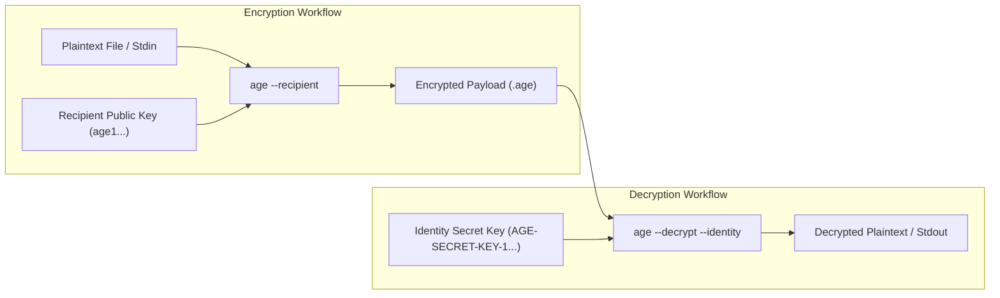
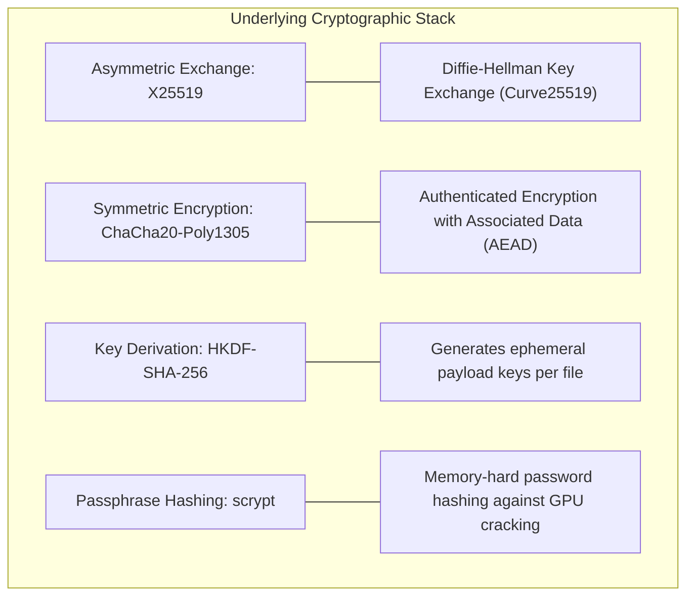
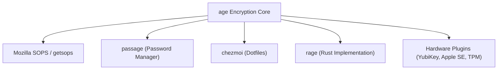

Encrypting files on the command line has historically been frustrating. For decades, developers and system administrators defaulted to **GnuPG (GPG)** or ad-hoc **OpenSSL** commands. In practice, both tools bring massive complexity: obscure CLI flags, legacy cryptographic algorithms, finicky background daemons, and endless configuration options that make secure usage difficult.

[age](https://github.com/FiloSottile/age) is a modern, simple, and secure file encryption tool designed to solve this problem. Created by cryptographer [Filippo Valsorda](https://words.filippo.io/) (the former Go cryptography lead at Google), `age` stands for *"Actually Good Encryption"* (a playful nod to PGP's "Pretty Good Privacy").

It features tiny keys that fit into text files, UNIX-style composability with standard streams, zero configuration files, and modern cryptographic primitives that eliminate cipher negotiation and downgrade attacks.



---

## 1. What Tools Does age Replace (and Why)?

To understand why `age` has become so popular, it helps to look at the pain points of the tools it replaces: primarily **GnuPG (GPG)** and **OpenSSL `enc`**.

### Replacing GnuPG (GPG)

For over twenty years, PGP/GPG was the de-facto standard for encrypting files and emails. However, GPG suffers from fundamental design issues:

- **Massive legacy baggage**: PGP was designed in the 1990s. Its specification supports dozens of deprecated ciphers and hashes (such as CAST5, 3DES, MD5, and SHA-1). Cipher agility allows downgrade attacks and complex parsing vulnerabilities.
- **Unfriendly CLI & cognitive load**: Encrypting a single file with GPG requires memorizing combinations like `gpg --encrypt --sign --armor --recipient user@example.com file.txt`. Decrypting requires dealing with keyring databases and trust models.
- **Flaky background daemons**: GPG relies on `gpg-agent`, socket directories, and GUI pinentry popups. If an agent hangs in a headless SSH session or CI/CD container, automated scripts stall indefinitely.
- **Key management overhead**: The "Web of Trust", public keyservers, key expiration dates, and subkey hierarchies add administrative friction for a task as simple as encrypting a backup archive.
- **Metadata leakage**: By default, standard PGP headers leak the key IDs of all recipients, exposing who is authorized to read the file.

`age` removes all of this. It does not do email encryption, digital signatures, or identity verification. It encrypts files and streams, and it does that with zero daemons, no key servers, and no configuration files.

### Replacing OpenSSL `enc`

Engineers frequently use `openssl enc -aes-256-cbc -pbkdf2` for quick symmetric encryption. While ubiquitous, OpenSSL was never meant to be an end-user file encryption tool:

- **No authenticated encryption by default**: Basic OpenSSL symmetric modes do not authenticate ciphertext. Tampering or truncation can go undetected or lead to padding oracle exploits.
- **Incompatible defaults across versions**: Key derivation iterations (`-iter`), salt handling, and default digests have changed between OpenSSL 1.1 and 3.x, leading to files encrypted on one OS version failing to decrypt on another.
- **No native public key recipient format**: Encrypting a file to someone else's public key using OpenSSL requires wrestling with X.509 certificates, S/MIME, or CMS/PKCS#7 commands (`openssl cms -encrypt -recip cert.pem`).

### Comparison Matrix

| Feature | `age` | `GnuPG (GPG)` | `OpenSSL (enc / cms)` |
| :--- | :--- | :--- | :--- |
| **Primary Goal** | Streamlined file encryption | Universal crypto suite (email, auth, sign) | TLS library & general cryptographic toolbox |
| **Modern Cryptography** | X25519, ChaCha20-Poly1305, HKDF, scrypt | Mixed (supports Ed25519, but retains legacy RSA/3DES) | Varies by chosen flags and OpenSSL version |
| **Authenticated Encryption** | Enforced by default (Poly1305) | Optional (MDC can be stripped in old formats) | Requires manual AEAD flag selection |
| **Public Key Format** | 58-character string (`age1...`) | Long hex fingerprint or 4 KiB ASCII block | X.509 PEM certificates or raw RSA blocks |
| **Background Daemons** | None | `gpg-agent`, `dirmngr`, `scdaemon` | None |
| **UNIX Pipes & Composability** | Flawless (stdin/stdout native) | Awkward (mixes status and stderr) | Moderate |
| **Configuration Files** | None | `~/.gnupg/gpg.conf`, `gpg-agent.conf` | `openssl.cnf` |

---

## 2. Under the Hood: Cryptographic Primitives

`age` follows modern cryptographic best practices popularized by tools like WireGuard and NaCl: **avoid cipher agility** (don't let the user pick bad algorithms), **enforce authenticated encryption**, and use **compact, unambiguous keys**.



Key features of the `age` format:
- **X25519 Key Exchange**: Public keys are 32-byte Curve25519 points encoded using Bech32, prefixed with `age1`. Private keys (identities) are encoded with the prefix `AGE-SECRET-KEY-1`.
- **Chunked Payload**: Files are encrypted in independent 64 KiB chunks using ChaCha20-Poly1305. This allows streaming encryption without buffering the entire file into memory. If any byte is altered, `age` rejects the file immediately.
- **Passphrase Encryption**: Symmetric encryption uses `scrypt` with a memory-hard work factor ($N=2^{18}, r=8, p=1$), making brute-force attacks significantly more expensive than standard PBKDF2 or SHA-256 loops.
- **SSH Key Interoperability**: `age` can encrypt natively to standard SSH public keys (`ssh-ed25519` and `ssh-rsa` $\ge$ 2048-bit), reusing existing system infrastructure.

---

## 3. Installation

`age` is distributed as two small static binaries: `age` (the encryption and decryption CLI) and `age-keygen` (the key generator).

### macOS
Install via Homebrew:
```bash
brew install age
```

### Ubuntu & Debian
Available in Debian 11+ and Ubuntu 21.04+:
```bash
sudo apt update
sudo apt install age
```

### Fedora & RHEL / CentOS
```bash
sudo dnf install age
```

### Arch Linux
```bash
sudo pacman -S age
```

### Alpine Linux
```bash
apk add age
```

### Go Toolchain
If you have Go installed:
```bash
go install filippo.io/age/cmd/...@latest
```

Verify the installation:
```bash
age --version
age-keygen --version
```

---

## 4. Practical Examples & Everyday Workflows

### Generating a Key Pair

To use public-key cryptography, generate an identity file containing your private key:

```bash
age-keygen --output key.txt
```

Output:
```text
Public key: age1ql3z7hjy54pw3hyww5ayyfg7zqgvc7w3j2elw8zmrj2kg5sfn9aqmcac8p
```

Let's inspect `key.txt`:
```bash
cat key.txt
```
```text
# created: 2026-10-23T10:00:00Z
# public key: age1ql3z7hjy54pw3hyww5ayyfg7zqgvc7w3j2elw8zmrj2kg5sfn9aqmcac8p
AGE-SECRET-KEY-10QW8S8R5...
```

> [!IMPORTANT]
> Keep `key.txt` secure and restrict its permissions:
> ```bash
> chmod 600 key.txt
> ```
> The public key (`age1...`) can be freely shared with anyone who wants to send you encrypted files. The `AGE-SECRET-KEY-1...` is private and must never be exposed.

---

### Encrypting and Decrypting with Public Keys

To encrypt a file for a recipient, use the `--recipient` (or `-r`) flag with their public key:

```bash
age --recipient age1ql3z7hjy54pw3hyww5ayyfg7zqgvc7w3j2elw8zmrj2kg5sfn9aqmcac8p secrets.env > secrets.env.age
```

Or specify the output file directly with `--output` (or `-o`):
```bash
age --recipient age1ql3z7hjy54pw3hyww5ayyfg7zqgvc7w3j2elw8zmrj2kg5sfn9aqmcac8p --output secrets.env.age secrets.env
```

To decrypt the file, use `--decrypt` (or `-d`) and provide your private key with `--identity` (or `-i`):

```bash
age --decrypt --identity key.txt secrets.env.age > secrets.env
```

---

### Symmetric Encryption with Passphrases

If you want to encrypt a file with a password rather than an asymmetric key pair, use the `--passphrase` (or `-p`) flag:

```bash
age --passphrase database-dump.sql > database-dump.sql.age
```

If you leave the password prompt empty, `age` will automatically generate a cryptographically secure random passphrase for you:

```console
$ age --passphrase database-dump.sql > database-dump.sql.age
Enter passphrase (leave empty to autogenerate a secure one):
Using the autogenerated passphrase "release-response-step-brand-wrap-ankle-pair-unusual-sword-train".
```

Decrypting passphrase-protected files does not require flags other than `--decrypt`:
```bash
age --decrypt database-dump.sql.age > database-dump.sql
```
`age` automatically detects that the file was encrypted with a passphrase and prompts you for it.

---

### Encrypting for Multiple Recipients

You can encrypt a file for multiple people simultaneously. Each recipient will be able to decrypt the exact same file using their own private key, without duplicating the payload:

```bash
age \
  --recipient age1alice42w9... \
  --recipient age1bob78zk1... \
  --recipient age1carol35m0... \
  --output secret-plans.pdf.age secret-plans.pdf
```

For teams or automated systems, store recipient keys in a text file (one key per line, with optional `#` comments):

```bash
# recipients.txt
# SRE Team Keys
age1alice42w9...
age1bob78zk1...
# CI Server
age1ci99k8q...
```

Encrypt against the whole list with `--recipients-file` (or `-R`):
```bash
age --recipients-file recipients.txt --output backup.tar.gz.age backup.tar.gz
```

---

### Encrypting with SSH Keys

One of `age`'s most convenient features is native support for SSH keys. You do not need to generate a new key pair if you already have an Ed25519 or RSA SSH key:

```bash
# Encrypt using an SSH public key file
age --recipients-file ~/.ssh/id_ed25519.pub --output config.tar.age config.tar

# Decrypt using your SSH private key
age --decrypt --identity ~/.ssh/id_ed25519 config.tar.age > config.tar
```

#### Encrypting directly to a colleague's GitHub public keys
Because GitHub publishes every user's public SSH keys at `https://github.com/<username>.keys`, you can encrypt a document for a colleague without asking them for a key:

```bash
curl -s https://github.com/torvalds.keys | age --recipients-file - --output message.txt.age message.txt
```
The recipient can immediately decrypt `message.txt.age` using their local SSH private key.

> [!NOTE]
> `age` does not support `ssh-agent` or keys held exclusively in hardware modules via SSH protocols for decryption. If your SSH key is protected with a passphrase, `age` will prompt you for the passphrase directly.

---

### UNIX Composability, Pipes, and ASCII Armor

`age` adheres to the UNIX philosophy: read from standard input if no file is provided, write to standard output, and maintain clean exit codes.

#### Stream an archive straight into an encrypted file:
```bash
tar -czf - ~/Documents/Project | age --recipient age1ql3z... > project-backup.tar.gz.age
```

#### Decrypt and unpack on the fly without writing unencrypted data to disk:
```bash
age --decrypt --identity key.txt project-backup.tar.gz.age | tar -xzf -
```

#### ASCII Armor for text copy-pasting
By default, `age` outputs raw binary. If you need to send encrypted text through Slack, email, GitHub issues, or Markdown files, pass `--armor` (or `-a`):

```bash
echo "DATABASE_PASSWORD=super-secret" | age --armor --recipient age1ql3z...
```

Output:
```text
-----BEGIN AGE ENCRYPTED FILE-----
YWdlLWVuY3J5cHRpb24ub3JnL3YxCi0+IFgyNTUxOSAwTVN3d...
-----END AGE ENCRYPTED FILE-----
```

---

### Passphrase-Protected Identity Files

If you store your private key (`key.txt`) on a shared drive, backup server, or cloud storage, you can encrypt the identity file itself with `age`:

```bash
age-keygen | age --passphrase > key.age
```

When decrypting files, `age --identity key.age` automatically prompts for the passphrase to unlock the identity:
```bash
age --decrypt --identity key.age secrets.env.age > secrets.env
```

---

## 5. Modern Adoption and Ecosystem

`age` is not just a standalone CLI; it has become the standard encryption layer for modern developer tools and GitOps architectures.



### 1. SOPS (Secrets OPerationS) & GitOps
In modern Kubernetes and cloud infrastructure, managing encrypted secrets inside Git repositories (GitOps with ArgoCD or Flux) is standard practice.

Historically, [SOPS](https://github.com/getsops/sops) relied on GPG or cloud KMS (AWS KMS, GCP KMS). Setting up GPG keys on developer machines, handling key expiration, and importing GPG rings into CI/CD pipelines caused persistent operational pain.

Today, **SOPS + age** is the gold standard for GitOps:
- Public keys are stored directly in `.sops.yaml` configuration files.
- CI/CD systems only need a single environment variable: `SOPS_AGE_KEY="AGE-SECRET-KEY-1..."`.
- Flux CD and Argo CD have native support for decrypting `age`-encrypted SOPS secrets without running GPG agents or mounting external keyrings.

### 2. Passage: Modernizing the UNIX Password Store
The standard UNIX password manager `pass` relied entirely on GPG. [Passage](https://github.com/FiloSottile/passage) is a drop-in fork created by Filippo Valsorda that replaces GPG with `age`. It allows managing passwords in a Git repo with standard text editors, YubiKey support, and zero GPG agent freezes.

### 3. Chezmoi: Sensitive Dotfiles
[chezmoi](https://www.chezmoi.io/) is one of the most widely used dotfiles managers. It includes built-in support for `age` to encrypt sensitive files (such as SSH private keys, AWS credentials, or personal tokens) before pushing dotfiles to a public GitHub repo.

### 4. Rage (Rust Implementation)
Jack Grigg (`str4d`) created [rage](https://github.com/str4d/rage), a complete implementation of the `age` specification written in Rust. `rage` provides independent verification of the format specification, exposes Rust crates for developers, and includes matching CLI tools (`rage` and `rage-keygen`).

### 5. Hardware Token Plugins
`age` features an extensible, lightweight plugin system based on UNIX executable discovery (`age-plugin-*`):
- **[age-plugin-yubikey](https://github.com/str4d/age-plugin-yubikey)**: Uses the PIV applet on YubiKeys (series 4 and 5) to protect secret keys with physical hardware presence (touch confirmation) and PINs.
- **[age-plugin-se](https://github.com/remko/age-plugin-se)**: Generates and uses keys stored in the **Apple Silicon Secure Enclave**, allowing decryption protected by macOS Touch ID.
- **[age-plugin-tpm](https://github.com/Foxboron/age-plugin-tpm)**: Binds keys to a hardware **TPM 2.0** chip on Linux workstations and servers.
- **[age-plugin-fido](https://github.com/abbbi/age-plugin-fido)**: Uses standard FIDO2 WebAuthn security keys.

---

## 6. What age Does NOT Do

Understanding the deliberate omissions in `age` is just as important as knowing what it can do:

- **No digital signatures**: `age` only encrypts and authenticates ciphertext. If you need to sign software releases, Git commits, or distribution packages, use tools designed specifically for signatures, such as [minisign](https://jedisct1.github.io/minisign/), [signify](https://man.openbsd.org/signify.1), or SSH signing (`git config gpg.format ssh`).
- **No identity validation or Web of Trust**: `age` does not verify whether `age1ql3z...` belongs to Alice or Bob. You verify recipient keys out-of-band (via a secure chat, configuration management, or 1Password), exactly like SSH keys.
- **No key rotation or expiration metadata**: Keys do not expire automatically. If a key is compromised, generate a new one and re-encrypt the target files.

---

## 7. Quick Reference Cheat Sheet

| Task | Command |
| :--- | :--- |
| **Generate a new keypair** | `age-keygen --output key.txt` |
| **Extract public key from identity** | `age-keygen -y key.txt` |
| **Encrypt to public key** | `age --recipient <recipient> --output file.age file` |
| **Decrypt with identity key** | `age --decrypt --identity key.txt file.age > file` |
| **Encrypt with passphrase** | `age --passphrase file > file.age` |
| **Decrypt passphrase file** | `age --decrypt file.age > file` |
| **Encrypt to multiple recipients** | `age --recipient <recip1> --recipient <recip2> --output file.age file` |
| **Encrypt from recipient list file** | `age --recipients-file recipients.txt --output file.age file` |
| **Encrypt using SSH public key** | `age --recipients-file ~/.ssh/id_ed25519.pub file > file.age` |
| **Decrypt using SSH private key** | `age --decrypt --identity ~/.ssh/id_ed25519 file.age > file` |
| **Encrypt to ASCII armor (text)** | `age --armor --recipient <recipient> file > file.age` |
| **Stream tar backup into age** | `tar czf - ./data \| age --recipient <recip> > data.tar.gz.age` |
| **Decrypt and unpack stream** | `age --decrypt --identity key.txt data.tar.gz.age \| tar xzf -` |

---

## Conclusion

`age` is a textbook example of modern command-line tool design: it solves one problem, eliminates decades of technical debt, selects uncompromising cryptographic primitives, and respects UNIX conventions.

Whether you are automating encrypted backups, managing GitOps secrets with SOPS, or securing personal sensitive files with your YubiKey, `age` is the cleanest and most dependable file encryption tool available today.
