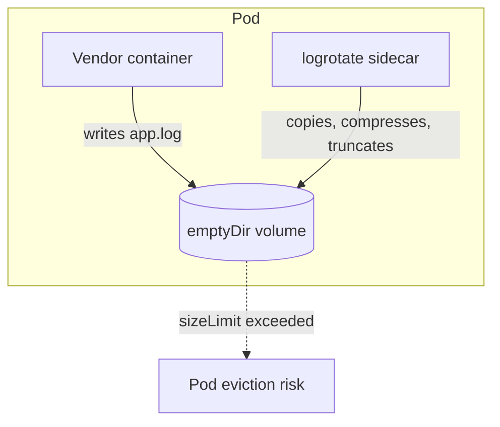

I had to deploy a third-party application as a pod. It wrote its logs to files, inside its own directory, and never rotated them. I had no control over the image, so I could not change how it logged. The logs grew until the disk filled.

This article walks through the pattern that contains it: a small sidecar container running `logrotate` over a shared volume, scheduled by `crond`, plus a size limit on that volume as a safety net. All without touching the vendor image.

My cluster runs Kubernetes 1.32.x, so the manifests below use a regular second container, which works on any version. I also cover two failure modes that stay quiet, and how to change the rotation policy later without restarting anything.

---

## Why the usual mechanism does not help

The kubelet already rotates container logs, but only the ones written to the container's `stdout` and `stderr` streams, the files you read with `kubectl logs`. Two kubelet settings control that rotation: `containerLogMaxSize` (default 10 Mi) and `containerLogMaxFiles` (default 5).

An application that writes to its own log files bypasses all of that. Those files live in the container's writable layer or in a mounted volume, and the kubelet does not manage them. They grow until the disk fills, and on a node under disk pressure the kubelet evicts pods; with hard eviction thresholds the shutdown is immediate, with no graceful period.

So the fix has to happen where the files are.



## Options on the table

| Option | Problem |
| --- | --- |
| Fix the image or add a startup wrapper | Not possible: the image is not mine |
| Ask the vendor for log options | Possible, but it depends on the vendor's support and release cycle, with no guaranteed timeline |
| Configure the app to log to `stdout` | Depends entirely on what the vendor's config supports |
| Streaming sidecar (`tail` the file to the sidecar's `stdout`) | Works, but adds a second copy of those logs on the node, and the original file keeps growing unless you also truncate it |
| **logrotate sidecar on the shared volume** | Rotates the file in place; the app keeps writing to the same file |

The [official Kubernetes logging documentation](https://kubernetes.io/docs/concepts/cluster-administration/logging/) names this exact approach: "sidecar containers can also be used to rotate log files that cannot be rotated by the application itself", with a small container running `logrotate` periodically as the example.

## The pattern

Three pieces: a shared `emptyDir` volume, the vendor container mounting it where the app writes, and a sidecar running `logrotate` against that same volume on a schedule.

### The sidecar image

The vendor image is untouchable, but the sidecar image is yours. This one is Alpine with the `logrotate` package, plus a small entrypoint that registers a cron schedule and starts `crond` in the foreground:

**Dockerfile**

```dockerfile
FROM alpine:3.24

RUN apk add --no-cache logrotate

COPY entrypoint.sh /entrypoint.sh
RUN chmod +x /entrypoint.sh

CMD ["/entrypoint.sh"]
```

**entrypoint.sh**

```sh
#!/bin/sh
set -e

CRON_SCHEDULE="${LOGROTATE_CRON:-*/10 * * * *}"

echo "Starting logrotate sidecar..."
echo "${CRON_SCHEDULE} /usr/sbin/logrotate /config/logrotate.conf" > /etc/crontabs/root

exec crond -f
```

BusyBox `crond` reads its crontabs from `/etc/crontabs/<user>`, so writing the file before `exec crond -f` is all the wiring it needs. A plain `while : ; do logrotate ...; sleep 600; done` loop works just as well; cron only buys you a familiar schedule syntax.

Note the path: logrotate reads its configuration from `/config/logrotate.conf`, not the classic `/etc/logrotate.conf`. The section on ConfigMap mounts below explains why.

> [!NOTE]
> Build this image yourself, pin a supported Alpine release (v3.24 is the current stable branch at the time of writing; check [alpinelinux.org/releases](https://alpinelinux.org/releases/)) or a digest, and scan it like any other image you run. Downloading and installing packages at container start is fine for a lab, not for a node you care about. BusyBox alone is not enough either: its binary ships `crond` but no `logrotate` applet, which is why the Dockerfile installs the package.

### The deployment

```yaml
apiVersion: apps/v1
kind: Deployment
metadata:
  name: vendor-app
spec:
  replicas: 1
  selector:
    matchLabels:
      app: vendor-app
  template:
    metadata:
      labels:
        app: vendor-app
    spec:
      containers:
        - name: vendor-app
          image: registry.example.com/vendor/app:1.2.3   # not yours to change
          volumeMounts:
            - name: applogs
              mountPath: /var/log/vendor-app   # wherever the vendor app writes
          resources:
            requests:
              ephemeral-storage: 100Mi
            limits:
              ephemeral-storage: 500Mi
        - name: logrotate
          image: registry.example.com/platform/logrotate-sidecar:1.0.0   # your image, built above
          env:
            - name: LOGROTATE_CRON
              value: "*/10 * * * *"
          volumeMounts:
            - name: applogs
              mountPath: /var/log/vendor-app
            - name: logrotate-config
              mountPath: /config
          resources:
            requests:
              ephemeral-storage: 10Mi
            limits:
              ephemeral-storage: 50Mi
      volumes:
        - name: applogs
          emptyDir:
            sizeLimit: 500Mi   # safety net, taken from node ephemeral storage
        - name: logrotate-config
          configMap:
            name: logrotate-config
```

Names and images are anonymized; the shape is the one running in production.

The sidecar mounts the ConfigMap as a **directory** at `/config`, with no `subPath`. That single decision is what lets you change the rotation policy later without restarting the pod. Do not mount it on top of `/etc`: a volume mounted over an existing directory hides its contents.

Since Kubernetes v1.29 you can instead define the sidecar as a native sidecar (an init container with `restartPolicy: Always`), which guarantees it starts before the app and plays nicer with jobs; the feature is active by default since v1.29 and stable since v1.33. On 1.32 a regular container like the one above is a perfectly good choice. Moving to the native form later is a small change for this specific container: it defines only `image`, `env`, `resources` and `volumeMounts`, all valid fields on an init container, with no `ports` or `probes` to translate, so the container moves under `initContainers` with `restartPolicy: Always` and the image, the ConfigMap and the volumes stay the same.

### The logrotate configuration

```yaml
apiVersion: v1
kind: ConfigMap
metadata:
  name: logrotate-config
data:
  logrotate.conf: |
    su root root
    /var/log/vendor-app/*.log {
        size 100M
        rotate 3
        compress
        missingok
        notifempty
        copytruncate
    }
```

- `size 100M` is a threshold checked at each run: when logrotate runs and the file has passed 100 MB, it rotates it. A trigger, not a cap: the file can grow past 100 MB between runs.
- `rotate 3` keeps three compressed generations.
- `copytruncate` is the key for an application with no usable mechanism to reopen its log file. Instead of renaming the file, logrotate copies it and then truncates the original to zero, and the application keeps writing to the same file descriptor.
- `su root root` rotates as that user and group instead of the default. With `crond` already running as root the identity is the same, but the line is not decorative: with no `su` directive at all, logrotate running as root skips rotation with an error whenever the log directory is world writable, or group writable with a non-root group. Any explicit `su` skips that directory permission check, so choose the value to reduce privileges, not to satisfy the check: the least privileged user and group that can read and write those logs. Verify the real owner and permissions of the log directory before production.

> [!WARNING]
> `copytruncate` has a cost. The logrotate man page warns that "there is a very small time slice between copying the file and truncating it, so some logging data might be lost." Whether that is acceptable depends on what those logs are worth to you; for audit-grade logs it is not. Also note that the copy step briefly doubles the space the live log occupies on the volume: size the volume with headroom for the largest active log, its retained generations, and one extra full copy during rotation.

How to think about the `sizeLimit`: it is a bound you choose, and no article can validate a number for you. A rotated generation can exceed `size` by whatever the application writes between two cron runs, so for every `*.log` file the pattern covers, the volume has to hold: the largest an active log can reach before rotation triggers (`size` plus peak growth between runs), `rotate` generations at that same maximum size (counted uncompressed to be safe; compressing them also takes transient space while it runs), and one extra full copy of that largest log while `copytruncate` works. The `sizeLimit: 500Mi` above is consistent with a single log file, `size 100M`, `rotate 3` and modest growth between runs; measure the real write rate, count the log files and add margin before trusting any number. Remember that the accounting is shared: the kubelet counts this volume toward the pod's ephemeral storage together with container writable layers and the pod's own logs.

---

## Changing the policy later: ConfigMap mount options

Sooner or later you will want to tune `size` or `rotate`. What happens next depends entirely on how the ConfigMap reaches the container. These are the three options, with their differences.

**Directory mount (what this deployment uses).** The ConfigMap mounts as a directory at `/config` and logrotate reads `/config/logrotate.conf`. When you edit the ConfigMap, Kubernetes projects the new content into the volume automatically. It is not instant: the total delay can be as long as the kubelet sync period plus the cache propagation delay, and with the default watch-based cache that is usually seconds to a couple of minutes. From that moment on, the next cron run reads the new file, because every run is a fresh logrotate process. No pod restart, no rollout. Only file contents propagate this way: the schedule itself, `LOGROTATE_CRON`, is an environment variable and still requires recreating the pod to change.

**File mount with `subPath`.** Mounting the key as a file drops it exactly at a path such as `/etc/logrotate.conf`, which some setups expect. The trade-off, straight from the [Kubernetes ConfigMap documentation](https://kubernetes.io/docs/concepts/configuration/configmap/): a container using a ConfigMap as a `subPath` volume mount does not receive ConfigMap updates. The running pod keeps the old policy until you recreate it.

**Helm checksum annotation (only if a chart renders this).** If the Deployment and ConfigMap come from a Helm chart, there is a third pattern: add an annotation to the pod template holding the SHA-256 of the rendered ConfigMap. A `helm upgrade` that changes the policy changes the checksum, which changes the pod template, which triggers a rollout, so new pods start with the new policy even when the file is mounted with `subPath`. Two costs to weigh: the rollout replaces the whole pod (application and sidecar) and the logs in the `emptyDir` do not carry over to the new pod; and nothing recalculates the checksum when you edit the ConfigMap by hand, while a later `helm upgrade` re-renders from the chart and can overwrite manual edits. Pick one source of truth for the file. The pattern is documented in the [Helm tips and tricks page](https://helm.sh/docs/howto/charts_tips_and_tricks/#automatically-roll-deployments); this deployment does not use Helm, so there is no chart to show.

Whatever the mount, a broken edit fails the next logrotate run silently. The habit that saves you is watching the volume for fresh compressed generations, not just the pod status.

---

## Two ways this pattern fails quietly

While reviewing a real deployment of this pattern and testing its configuration locally, two failure modes showed up. Neither makes anything fail loudly.

### `-f` quietly turns size-based rotation into time-based rotation

The deployment in question ran `logrotate -f /etc/logrotate.conf`. Whatever the reason it ended up there, `-f` means "rotate even if no condition says to". A local run against the config above (`size 100M`) with logrotate 3.19.0 confirmed it: a 13-byte log file rotated immediately under `-f`, while `notifempty` still skipped an empty file. In that deployment, with its ten-minute schedule and `rotate 10`, that meant roughly the last 100 minutes of logs, assuming a valid schedule and every run succeeding, rather than ten chunks of 100 MB. Neither behavior is wrong, but they are different designs: size-based retention or time-based retention. Pick one. Dropping `-f` makes the cron a check cadence: the schedule decides how often logrotate looks, not whether it rotates.

### An unbounded volume, and a size limit that is a net, not a guarantee

That deployment used a bare `emptyDir: {}`. Rotation caps the log files themselves, but if rotation ever stops, or the app writes files the glob does not match (the pattern only covers `*.log`), nothing else bounds that volume. Adding `sizeLimit` plus ephemeral-storage requests and limits turns a sidecar failure back into a bounded problem: the kubelet tracks each pod's ephemeral storage and evicts pods that exceed their limits. Keep the wording honest, though: the kubelet evaluates this on its housekeeping interval (10 seconds by default), eviction is reactive, and other pods, container layers and image overlays share the same node storage. A `sizeLimit` caps what this pod may write; it is a safety net, not a promise that the node never fills. And check what actually lands in the log directory with `kubectl exec deploy/vendor-app -- ls -la /var/log/vendor-app`, widening the glob if the app writes more than `*.log`.

Two smaller notes. First, logrotate keeps a state file and takes a lock on it by default; the man page documents `/var/lib/logrotate.status` as the default path (builds differ) and `/dev/null` as the way to disable state entirely. In this cron design each run is independent, but a state path the container cannot write will fail the run, visible in the sidecar logs. Second, the clearest signal that all of this works is new compressed generations appearing with fresh timestamps. Watch the volume, not just the pod status.

---

## Try it in a lab before production

I would not roll this straight into a real cluster. On a throwaway `kind` or `minikube` cluster:

1. Replace the vendor container with a log generator to see rotation happen in minutes, for example a BusyBox container running `sh -c 'while : ; do dd if=/dev/zero bs=1024 count=1 2>/dev/null | tr '\0' 'x' >> /var/log/vendor-app/app.log; usleep 100000; done'`. That writes about 10 KB/s, so with `size 1M` below you see a rotation every couple of minutes.
2. Lower `size` to something small, like `size 1M`, so you do not wait for 100 MB.
3. Watch the volume: `kubectl exec deploy/vendor-app -c logrotate -- ls -lh /var/log/vendor-app`. You should see `app.log` shrink and compressed generations appear.
4. To see the cron path work end to end, set `LOGROTATE_CRON` to `* * * * *` in the lab so it runs every minute.
5. To watch a policy change propagate, edit the ConfigMap with `kubectl edit configmap logrotate-config`, lower `size` again, and wait: once Kubernetes projects the update, the next run applies it with the pod untouched.
6. To watch the `sizeLimit` act, set it small (for example `sizeLimit: 20Mi`), drop the `usleep` from the generator so the volume fills fast, and run `kubectl get pod -w`. Eviction is reactive, not instant: the kubelet evaluates usage periodically (the default housekeeping interval is 10s), so expect the pod to be evicted shortly after it crosses the limit, not at the exact moment. Then `kubectl describe pod` shows an `Evicted` status with an ephemeral-storage message, and `kubectl get events` shows the eviction event.

> [!NOTE]
> The logrotate behaviors described in this article were verified locally against test files on Linux (logrotate 3.19.0): no rotation under the size threshold without `-f`; immediate rotation of a 13-byte file with `-f`; empty files skipped even under `-f` thanks to `notifempty`; `copytruncate` leaving the original at zero bytes with all content preserved in the compressed generation; retention limited exactly to the configured generations. The Kubernetes manifests and the lab steps have not been run on a cluster for this article; try them in your own environment.

---

## What this pattern does not do

- **It is not log shipping.** Rotation keeps the disk healthy; it does not get logs to a central system. If you need search and retention, run a logging agent ([the same documentation](https://kubernetes.io/docs/concepts/cluster-administration/logging/) covers a sidecar with an agent, or a node-level agent) and keep rotation as the disk safety layer. Mind the interaction: an agent tailing the file while `copytruncate` works can miss the lines written in the copy-truncate window.
- **It does not survive pod deletion.** `emptyDir` data is deleted permanently when the pod leaves the node.
- **It does not fix unbounded growth inside the rotation window.** A burst can still fill the volume between two runs; the `sizeLimit` bounds the blast radius, no more.
- **It may drop a few lines per rotation**, by design of `copytruncate`.

---

## Glossary

- **Sidecar**: a secondary container in the same pod that supports the main one. The native form, an init container with `restartPolicy: Always`, is enabled by default since v1.29 and stable since v1.33; a regular second container works on any version.
- **crond**: the cron daemon. Alpine ships BusyBox `crond`, which reads per-user crontabs from `/etc/crontabs/`.
- **emptyDir**: an empty volume created when the pod is assigned to a node, shared by all containers in the pod and deleted with the pod.
- **Ephemeral storage**: local node disk used by container writable layers, `emptyDir` volumes and the pod's own logs. The kubelet accounts for it and can evict pods that exceed their limits.
- **Eviction**: the kubelet terminating a pod to reclaim node resources, for example under disk pressure.
- **copytruncate**: a logrotate mode that copies the log file and then empties the original, for programs that cannot be asked to reopen their log file.
- **ConfigMap**: a Kubernetes object that holds configuration data, mountable as files in a volume or exposed as environment variables.
- **subPath**: a volume mount option that mounts a single key or file instead of the whole volume; ConfigMaps mounted this way do not receive updates.

---

## Summary

- A third-party container that logs to files needs rotation where the files live: a small logrotate sidecar over a shared `emptyDir`, without touching the vendor image.
- Mount the ConfigMap as a directory and point logrotate at it: policy edits propagate on their own and the next cron run picks them up, with no rollout. `subPath` mounts do not receive updates, and the Helm checksum annotation forces a rollout instead.
- `size` decides when rotation happens; `-f` turns that into time-based retention. Choose one design.
- Add `sizeLimit` and ephemeral-storage limits: they turn a stopped sidecar back into a bounded problem, with eviction as the reactive backstop.
- Verify locally, then in a lab cluster: the signal that matters is fresh compressed generations in the volume.

## References

- [Kubernetes: Logging Architecture](https://kubernetes.io/docs/concepts/cluster-administration/logging/)
- [Kubernetes: Sidecar Containers](https://kubernetes.io/docs/concepts/workloads/pods/sidecar-containers/)
- [Kubernetes: Volumes (emptyDir)](https://kubernetes.io/docs/concepts/storage/volumes/#emptydir)
- [Kubernetes: Resource Management for Pods and Containers](https://kubernetes.io/docs/concepts/configuration/manage-resources-containers/)
- [Kubernetes: ConfigMaps (mounted ConfigMaps are updated automatically; `subPath` mounts are not)](https://kubernetes.io/docs/concepts/configuration/configmap/)
- [Kubernetes: Node-pressure Eviction](https://kubernetes.io/docs/concepts/scheduling-eviction/node-pressure-eviction/)
- [Kubernetes: Images (imagePullPolicy)](https://kubernetes.io/docs/concepts/containers/images/)
- [Helm: Automatically roll deployments (checksum annotation)](https://helm.sh/docs/howto/charts_tips_and_tricks/#automatically-roll-deployments)
- [logrotate(8) man page](https://man7.org/linux/man-pages/man8/logrotate.8.html)
- [logrotate source code, tag 3.19.0 (permission check for root without `su`)](https://github.com/logrotate/logrotate/blob/3.19.0/logrotate.c)
- [Alpine Linux releases](https://alpinelinux.org/releases/)
