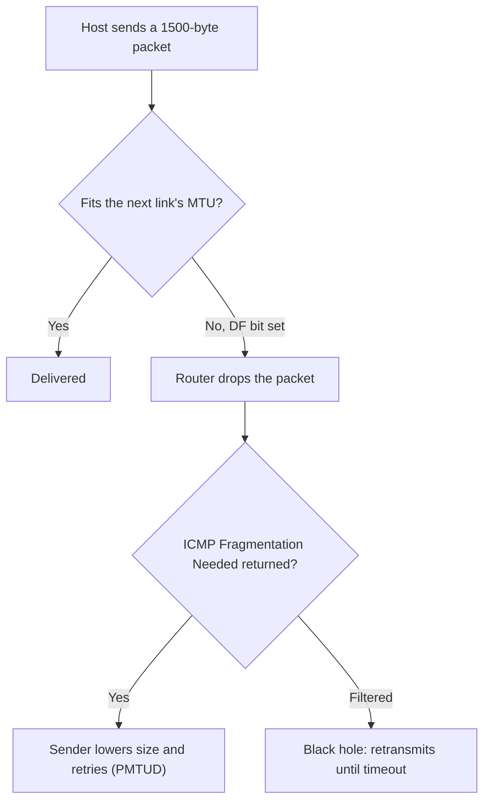

At work we ran into connection errors between servers that were hard to explain: some connections worked while others stalled for no obvious reason. One of the suspects was a different MTU configured on servers and switch ports. I will not claim that turned out to be the root cause, because this kind of fault is only confirmed by measuring, but I realized I did not really understand how MTU works under the hood, so I went and learned it properly. This article is what I found: what MTU is, what actually happens when two ends of a path disagree on it, how to diagnose the mismatch with tools you already have, and what the fixes look like.

## The symptom

An MTU problem has a very recognizable signature: small packets get through and large ones do not.

- `ping` works, because its default packets are small.
- SSH connects, but freezes as soon as something prints a lot of output, like a long directory listing or a `cat` of a big file.
- TLS handshakes stall halfway, so HTTPS pages never finish loading.
- Transfers start fine and die a few kilobytes in.

The errors look random and intermittent because they depend on packet size, not on time of day or load. If that pattern sounds familiar, MTU earns a place on the suspect list. Other faults can produce similar symptoms (a bad NIC, congestion), so the point is not to assume: it is to measure.

## What MTU is

MTU (Maximum Transmission Unit) is the largest packet an interface will send in one shot. On Ethernet, the standard (IEEE 802.3) sets it at 1500 bytes, and that is the default almost everywhere.

A useful analogy: the height limit of the bridges along a road. A truck taller than the lowest bridge on its route cannot get through, even if every bridge in its home city is tall. Your server can have a perfectly valid MTU and still fail because some link along the path is lower.

Typical values:

| MTU | Where you see it |
| --- | --- |
| 1500 | Standard Ethernet, the default |
| 9000 | Jumbo frames, common in datacenter and storage networks |
| ~1450 | Overlays and tunnels (VXLAN, some cloud networks), due to the extra headers |
| 1280 | The mandatory minimum in IPv6 (RFC 8200) |

## What happens when it does not match

IPv4 could in theory fragment packets on the way, but TCP traffic today almost always carries the DF (Don't Fragment) bit, so routers are not allowed to split it. When a packet with DF arrives at a link whose MTU is too small, the router drops it and is supposed to send back an ICMP Fragmentation Needed message (type 3, code 4) carrying the MTU that would fit. The sender then lowers its packet size for that destination and retries. That mechanism is Path MTU Discovery (PMTUD), defined in RFC 1191.

When PMTUD works, a mismatch costs one retry and the connection carries on, slightly slower. You never notice it.

## The ICMP black hole

The failure mode behind the weird symptoms is the black hole: a firewall or filter along the path drops ICMP traffic, so the Fragmentation Needed notice never reaches the sender. The sender keeps retransmitting the full-size packet until the connection times out. Small packets pass, large packets vanish without explanation. That is exactly the signature from the first section.

Overly strict firewalls are the usual culprit: blocking all inbound ICMP breaks PMTUD, which relies on it. Cloudflare has a good writeup of how this plays out in practice (linked in the references), and it is a recurring theme in VPN and tunnel deployments, where the tunnel's overhead shrinks the effective MTU below what the endpoints assume.

## Jumbo frames and the L2 domain rule

Jumbo frames (usually 9000 bytes) are common in datacenter networks because larger packets mean less per-packet overhead for storage and replication traffic. Two things matter here:

- 9000 is a convention, not a standard. Equipment picks its own maximum, and not everything agrees on the same value.
- The entire layer 2 domain must agree: every server, switch port and VLAN in the path needs the same MTU.

If a server configured at 9000 talks to a switch port configured at 1500, the large frames are dropped silently at layer 2. There is no ICMP notice and no PMTUD, because a switch does not route, fragment or send errors: it simply discards what does not fit. This is the nastiest variant of the problem, because nothing in the logs explains it.

## Diagnosis step by step

1. Check the MTU of each interface, on both ends: `ip link show`.
2. Measure the real path MTU with `ping -M do -s 1472 <destination>`. `-M do` sets the DF bit and `-s 1472` is the payload size; 1472 payload + 20 bytes of IP header + 8 bytes of ICMP header = 1500. If it goes through, the path admits 1500. If not, lower the value until it passes: the largest working value plus 28 is the path MTU.
3. `tracepath <destination>` reports the path MTU directly and often shows the hop where it changes.
4. Test in both directions. Fixing one direction does not fix the other.
5. Interpret the results. A `message too long, mtu=X` error is good news: PMTUD is working and X tells you the limit. Total silence means something is filtering ICMP.
6. Watch whether the notices arrive at all: `sudo tcpdump -ni <interface> icmp` while you run the large pings.
7. On managed switches, check the per-port and per-VLAN MTU settings and the discard counters, which is where silent layer 2 drops show up.

| Command | What it tells you |
| --- | --- |
| `ip link show` | The MTU configured on each interface |
| `ping -M do -s 1472 <destination>` | Whether the path admits 1500-byte packets without fragmentation |
| `tracepath <destination>` | The discovered path MTU and the hop where it drops |
| `sudo tcpdump -ni <interface> icmp` | Whether ICMP fragmentation notices actually arrive |

## Fixes

- **Align the MTU across the whole path.** This is the correct fix. If you enable jumbo frames, enable the same value on every device in the layer 2 domain.
- **Lower the MTU on the endpoint** when you do not control the path: `ip link set dev <interface> mtu 1450`, and make it persistent in your network configuration. Keep in mind this fixes one direction on one host.
- **Enable PLPMTUD as a safety net**: set `net.ipv4.tcp_mtu_probing=1` (RFC 4821). TCP then probes for a working size on its own when packets go missing, without depending on ICMP. The value `1` probes only when a black hole is suspected; `2` probes always. The [kernel ip-sysctl documentation](https://www.kernel.org/doc/html/latest/networking/ip-sysctl.html) describes both.
- **MSS clamping on the router or firewall**: rewrite the TCP MSS option of passing connections so sessions never attempt packets larger than the path admits (for example with the iptables `TCPMSS` target and `--clamp-mss-to-pmtu`). It works, but it is a workaround that hides the mismatch rather than fixing it.

> [!WARNING]
> Whatever you change, test both directions afterwards. A path that works from A to B can still be broken from B to A.

## A note on Kubernetes

Overlay networks spend part of the MTU on their own headers. With flannel in VXLAN mode, the VXLAN encapsulation adds 50 bytes of headers, so the MTU inside a pod ends up 50 bytes below the physical network's: typically 1450 on a standard 1500 network. Compare `ip link show` on the node and inside a pod to see both values. If the pod MTU is larger than what the underlying network actually admits between nodes, you get the same silent drops described above, this time between pods on different nodes.

## Glossary

- **MTU (Maximum Transmission Unit)**: the largest packet an interface sends in one shot. 1500 bytes on standard Ethernet.
- **DF (Don't Fragment)**: an IPv4 header bit that forbids routers from splitting the packet. TCP traffic almost always carries it.
- **ICMP**: the protocol network devices use to report errors, including Fragmentation Needed notices.
- **Path MTU Discovery (PMTUD)**: the mechanism (RFC 1191) by which a sender learns the smallest MTU along a path from ICMP notices and lowers its packet size accordingly.
- **Black hole**: a path where ICMP notices are filtered, so the sender never learns why its large packets disappear.
- **Jumbo frames**: Ethernet frames larger than the standard 1500 bytes, usually 9000. A convention, not a standard; the whole layer 2 domain must agree.
- **Layer 2 domain**: the set of devices and ports connected at the Ethernet level (switches, VLANs, server ports) without routing in between.
- **MSS clamping**: rewriting the TCP Maximum Segment Size option in transit so connections never try oversized packets.
- **VXLAN**: an overlay network protocol that tunnels layer 2 traffic over UDP, adding 50 bytes of headers per packet.

## Summary

- The MTU mismatch signature is distinctive: small packets pass, large packets hang. SSH that connects and then freezes is the classic case.
- PMTUD depends on ICMP Fragmentation Needed notices coming back. If a firewall filters them, the path becomes a black hole and connections stall without explanation.
- Jumbo frames are all or nothing: every device in the layer 2 domain must share the same MTU, or large frames die silently at the switch.
- Diagnose by measuring, not by assuming: `ping -M do -s 1472`, `tracepath`, both directions, and `tcpdump` to see whether ICMP notices arrive.
- The real fix is aligning the MTU along the path; `net.ipv4.tcp_mtu_probing=1` is a worthwhile safety net while you get there.

## References

- [RFC 1191: Path MTU Discovery](https://www.rfc-editor.org/rfc/rfc1191.html)
- [RFC 4821: Packetization Layer Path MTU Discovery](https://www.rfc-editor.org/rfc/rfc4821.html)
- [RFC 8200: IPv6 (1280-byte minimum MTU)](https://www.rfc-editor.org/rfc/rfc8200.html)
- [Cloudflare: Path MTU Discovery in practice](https://blog.cloudflare.com/path-mtu-discovery-in-practice/)
- [Hetzner Docs: MTU troubleshooting](https://docs.hetzner.com/networking/networks/troubleshooting/mtu/)
- [NETGEAR: Guidance on the use of jumbo frames](https://kb.netgear.com/25091/Guidance-on-the-use-of-jumbo-frames)
- [flannel issue #1775: setting MTU in kube-flannel.yml](https://github.com/flannel-io/flannel/issues/1775)
- [Linux kernel: ip-sysctl documentation (`tcp_mtu_probing`)](https://www.kernel.org/doc/html/latest/networking/ip-sysctl.html)
