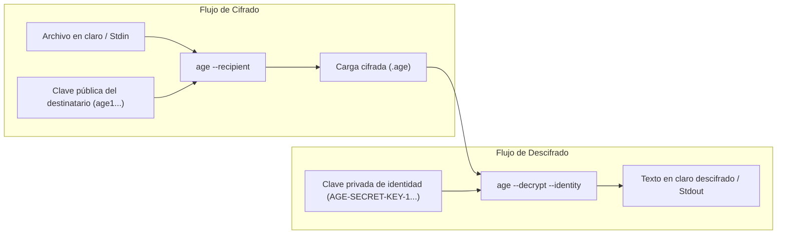
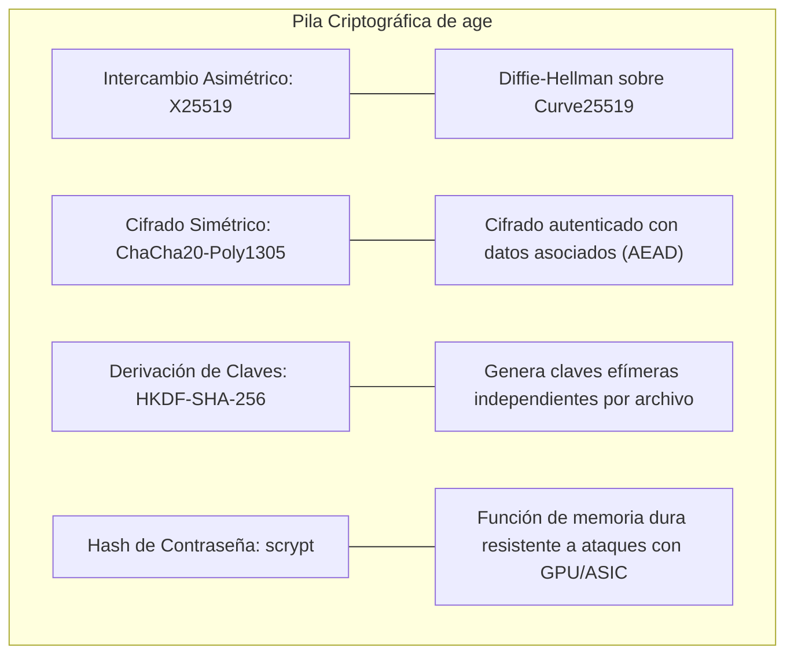
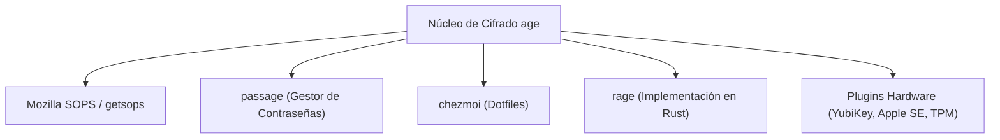

Cifrar archivos desde la línea de comandos siempre ha sido una tarea frustrante. Durante décadas, administradores de sistemas y desarrolladores recurrieron a **GnuPG (GPG)** o a comandos improvisados de **OpenSSL**. En la práctica, ambas herramientas acarrean una enorme complejidad: opciones crípticas en la CLI, algoritmos criptográficos obsoletos, demonios en segundo plano problemáticos y cientos de configuraciones propensas a errores.

[age](https://github.com/FiloSottile/age) es una herramienta de cifrado de archivos moderna, simple y segura diseñada para resolver este problema de raíz. Creada por el criptógrafo [Filippo Valsorda](https://words.filippo.io/) (ex-responsable de seguridad y criptografía en Go en Google), su nombre significa *"Actually Good Encryption"* (un juego de palabras en respuesta al *"Pretty Good Privacy"* de PGP).

Destaca por claves compactas que caben en una sola línea de texto, total compatibilidad con flujos de trabajo UNIX (tuberías, entrada y salida estándar), ausencia absoluta de archivos de configuración y primitivas criptográficas modernas que eliminan la negociación de algoritmos y los ataques de degradación.



---

## 1. ¿A qué herramientas sustituye age (y por qué)?

Para entender por qué `age` se ha adoptado con tanta rapidez, conviene analizar las fricciones de las soluciones históricas: principalmente **GnuPG (GPG)** y **OpenSSL `enc`**.

### Sustituyendo a GnuPG (GPG)

Durante más de 20 años, PGP/GPG fue el estándar por defecto para cifrar archivos y correos electrónicos. Sin embargo, su diseño arrastra graves deficiencias:

- **Deuda técnica acumulada**: Diseñado en los años 90, el estándar PGP soporta decenas de algoritmos y hashes obsoletos (como CAST5, 3DES, MD5 o SHA-1). La negociación de cifrados abre la puerta a ataques de degradación (*downgrade attacks*) y problemas de parseo.
- **CLI hostil y alta carga cognitiva**: Cifrar un simple archivo con GPG requiere memorizar combinaciones como `gpg --encrypt --sign --armor --recipient usuario@ejemplo.com archivo.txt`. Para descifrarlo hay que lidiar con llaveros locales (*keyrings*) y modelos de confianza.
- **Demonios problemáticos en segundo plano**: GPG depende de `gpg-agent`, sockets en `/run` o `/tmp` y utilidades visuales de `pinentry`. Si un agente falla en una sesión SSH o en un pipeline de CI/CD sin interfaz gráfica, el proceso se bloquea indefinidamente.
- **Sobrecarga de gestión de claves**: La "Red de Confianza" (*Web of Trust*), los servidores públicos de claves caídos o desactualizados, las fechas de caducidad y las subclaves complican una tarea tan común como cifrar un backup o un secreto.
- **Fuga de metadatos**: Las cabeceras estándar de PGP exponen por defecto los identificadores de clave de todos los destinatarios, revelando quién tiene acceso al documento.

`age` prescinde de todo eso. No gestiona correo electrónico, no implementa firmas digitales ni redes de confianza. Se dedica única y exclusivamente a cifrar archivos y flujos de datos, sin demonios, sin servidores de claves y sin archivos de configuración.

### Sustituyendo a OpenSSL `enc`

Muchos administradores usan `openssl enc -aes-256-cbc -pbkdf2` para cifrar ficheros rápidamente con contraseña. Sin embargo, OpenSSL nunca fue concebido como una utilidad de usuario final:

- **Sin autenticación por defecto**: Los modos simétricos clásicos de OpenSSL no comprueban la autenticidad del contenido. Cualquier modificación accidental o maliciosa del archivo cifrado puede pasar inadvertida o causar vulnerabilidades de oráculo de relleno (*padding oracle*).
- **Parámetros incompatibles entre versiones**: El número de iteraciones de PBKDF2 (`-iter`), el manejo de la sal (*salt*) y las funciones de resumen predeterminadas han variado sustancialmente entre OpenSSL 1.1 y 3.x, provocando que archivos cifrados en una máquina no puedan descifrarse en otra.
- **Sin formato nativo de destinatarios públicos**: Cifrar para la clave pública de otra persona mediante OpenSSL obliga a gestionar certificados X.509, S/MIME o comandos complejos de CMS/PKCS#7 (`openssl cms -encrypt -recip cert.pem`).

### Tabla comparativa

| Característica | `age` | `GnuPG (GPG)` | `OpenSSL (enc / cms)` |
| :--- | :--- | :--- | :--- |
| **Objetivo principal** | Cifrado directo y seguro de archivos | Suite criptográfica universal (email, firma, auth) | Librería TLS y utilidades criptográficas generales |
| **Criptografía moderna** | X25519, ChaCha20-Poly1305, HKDF, scrypt | Mixta (soporta Ed25519, pero mantiene RSA/3DES) | Depende de los flags elegidos y la versión instalada |
| **Cifrado autenticado** | Obligatorio: detecta alteraciones | Depende del formato y la versión | `enc` no lo admite; `cms` ofrece otras opciones |
| **Formato de clave pública** | Cadena de 62 caracteres (`age1...`) | Huella hex larga o bloque ASCII de varios KiB | Certificados PEM X.509 o bloques RSA en crudo |
| **Demonios en segundo plano** | Ninguno | `gpg-agent`, `dirmngr`, `scdaemon` | Ninguno |
| **Tuberías UNIX (pipes)** | Impecable (diseño nativo para stdin/stdout) | Complicado (mezcla mensajes de estado con stderr) | Moderado |
| **Archivos de configuración** | Ninguno | `~/.gnupg/gpg.conf`, `gpg-agent.conf` | `openssl.cnf` |

---

## 2. Funcionamiento interno: Primitivas criptográficas

`age` sigue las mejores prácticas de la criptografía actual (popularizadas por herramientas como WireGuard y NaCl): **eliminar la agilidad de cifrado** (no dar opciones al usuario para elegir algoritmos inseguros), **garantizar el cifrado autenticado** y utilizar **claves concisas y legibles**.



Aspectos clave del formato `age`:
- **Claves públicas y privadas**: La clave pública sirve para cifrar archivos destinados a una persona. En age empieza por `age1` y puedes compartirla. La clave privada permite descifrarlos, empieza por `AGE-SECRET-KEY-1` y debes guardarla en secreto.
- **Archivos grandes sin llenar la RAM**: age cifra y comprueba los datos por bloques de hasta 64 KiB. Si detecta una alteración o un archivo incompleto, termina con un error. Puede haber escrito parte del resultado antes de detectar el problema: comprueba siempre que el comando termine correctamente antes de usarlo.
- **Cifrado por contraseña**: age usa `scrypt` para que probar muchas contraseñas consuma más tiempo y memoria. Aun así, elige una contraseña larga y difícil de adivinar, o deja que age genere una.
- **Interoperabilidad con claves SSH**: Permite cifrar de manera nativa utilizando claves públicas de SSH ya existentes (`ssh-ed25519` y `ssh-rsa` $\ge$ 2048 bits).

---

## 3. Instalación

`age` se compone de dos ejecutables estáticos muy ligeros: `age` (la herramienta principal de cifrado y descifrado) y `age-keygen` (el generador de claves).

### macOS
Mediante Homebrew:
```bash
brew install age
```

### Ubuntu y Debian
En Debian 12+ y Ubuntu 22.04+, mediante los repositorios de la distribución:
```bash
sudo apt update
sudo apt install age
```

### Fedora
```bash
sudo dnf install age
```

### Arch Linux
```bash
sudo pacman -S age
```

### Alpine Linux
```bash
apk add age
```

### Entorno de desarrollo Go
Si tienes instalado Go:
```bash
go install filippo.io/age/cmd/...@latest
```

Comprueba que la instalación funciona:
```bash
age --version
age-keygen --version
```

---

## 4. Ejemplos prácticos y flujos de trabajo habituales

### Generar un par de claves

Para utilizar criptografía asimétrica, genera un archivo de identidad que contenga tu clave privada:

```bash
age-keygen --output key.txt
```

Ejemplo de salida (tu clave pública será distinta):
```text
Public key: age1ql3z7hjy54pw3hyww5ayyfg7zqgvc7w3j2elw8zmrj2kg5sfn9aqmcac8p
```

Si examinamos el archivo `key.txt`:
```bash
cat key.txt
```
```text
# created: 2026-10-23T10:00:00Z
# public key: age1ql3z7hjy54pw3hyww5ayyfg7zqgvc7w3j2elw8zmrj2kg5sfn9aqmcac8p
AGE-SECRET-KEY-10QW8S8R5...
```

> [!IMPORTANT]
> Protege el archivo de clave privada reduciendo sus permisos en el sistema:
> ```bash
> chmod 600 key.txt
> ```
> La clave pública (`age1...`) puedes compartirla libremente con cualquiera que necesite enviarte información cifrada. La clave secreta (`AGE-SECRET-KEY-1...`) es estrictamente personal y no debe compartirse jamás.

---

### Cifrar y descifrar con claves públicas

Primero obtén la clave pública de la identidad que acabas de generar y guárdala en una variable:


```bash
age --recipient "$RECIPIENT" secrets.env > secrets.env.age
```

O indica el archivo resultante directamente con `--output` (o `-o`):
```bash
age --recipient "$RECIPIENT" --output secrets.env.age secrets.env
```

Para descifrar el archivo, utiliza el flag `--decrypt` (o `-d`) e introduce tu clave privada con `--identity` (o `-i`):

```bash
age --decrypt --identity key.txt secrets.env.age > secrets.env
```

---

### Cifrado simétrico mediante contraseña

Si prefieres cifrar un archivo con una contraseña en lugar de un par de claves, utiliza el flag `--passphrase` (o `-p`):

```bash
age --passphrase base-datos.sql > base-datos.sql.age
```

Si dejas la contraseña en blanco en el prompt interactivo, `age` generará automáticamente una contraseña aleatoria de alta entropía lista para usar:

```console
$ age --passphrase base-datos.sql > base-datos.sql.age
Enter passphrase (leave empty to autogenerate a secure one):
Using the autogenerated passphrase "release-response-step-brand-wrap-ankle-pair-unusual-sword-train".
```

Para descifrar un archivo protegido con contraseña, solo necesitas `--decrypt`:
```bash
age --decrypt base-datos.sql.age > base-datos.sql
```
`age` detecta automáticamente que el archivo se protegió con contraseña y te la solicitará en la terminal.

---

### Cifrar para varios destinatarios simultáneos

Puedes cifrar el mismo archivo para varios destinatarios; cada uno podrá descifrarlo con su clave privada. Los ejemplos siguientes son plantillas: sustituye todas las claves con `...` por claves públicas completas y válidas.

```bash
age \
  --recipient age1alice42w9... \
  --recipient age1bob78zk1... \
  --recipient age1carol35m0... \
  --output planes-secretos.pdf.age planes-secretos.pdf
```

Para equipos o entornos automatizados, puedes almacenar los destinatarios en un archivo de texto (un destinatario por línea, admitiendo comentarios con `#`):

```bash
# destinatarios.txt
# Claves del equipo de SRE
age1alice42w9...
age1bob78zk1...
# Servidor de despliegue continuo
age1ci99k8q...
```

Cifra contra todo el listado utilizando `--recipients-file` (o `-R`):
```bash
age --recipients-file destinatarios.txt --output backup.tar.gz.age backup.tar.gz
```

---

### Cifrar utilizando claves SSH existentes

Una de las grandes comodidades de `age` es su soporte nativo para claves SSH. No necesitas crear un nuevo par de claves si ya cuentas con una clave SSH Ed25519 o RSA:

```bash
# Cifrar utilizando una clave pública SSH local
age --recipients-file ~/.ssh/id_ed25519.pub --output config.tar.age config.tar

# Descifrar utilizando la clave privada SSH correspondiente
age --decrypt --identity ~/.ssh/id_ed25519 config.tar.age > config.tar
```

#### Cifrar directamente para las claves de GitHub de un compañero
Dado que GitHub expone las claves SSH públicas de cualquier usuario en `https://github.com/<usuario>.keys`, puedes cifrar un documento para un compañero de equipo sin pedirle su clave de antemano:

```bash
curl -s https://github.com/torvalds.keys | age --recipients-file - --output mensaje.txt.age mensaje.txt
```
El destinatario podrá descifrar `mensaje.txt.age` de forma inmediata con su clave privada SSH local.

> [!NOTE]
> `age` no utiliza `ssh-agent` ni tokens hardware gestionados por agentes SSH para el descifrado. Si la clave SSH privada tiene contraseña, `age` solicitará dicha contraseña directamente en la terminal.

---

### Tuberías UNIX y formato blindado ASCII Armor

`age` sigue escrupulosamente la filosofía UNIX: lee de la entrada estándar si no se pasa archivo, escribe en la salida estándar y utiliza códigos de salida claros.

#### Crear un archivo comprimido y cifrarlo al vuelo:
```bash
tar -czf - ~/Proyectos/Documentos | age --recipient "$RECIPIENT" > backup-proyectos.tar.gz.age
```

#### Descifrar y descomprimir sin tocar el disco en texto claro:
```bash
age --decrypt --identity key.txt backup-proyectos.tar.gz.age | tar -xzf -
```

#### Formato ASCII Armor para copiar y pegar texto
Por defecto, `age` genera un archivo binario. Si necesitas pegar el contenido cifrado en un mensaje de chat, un correo, un issue de GitHub o un documento Markdown, añade el flag `--armor` (o `-a`):

```bash
echo "DATABASE_PASSWORD=super-secreto" | age --armor --recipient "$RECIPIENT"
```

Salida del comando:
```text
-----BEGIN AGE ENCRYPTED FILE-----
YWdlLWVuY3J5cHRpb24ub3JnL3YxCi0+IFgyNTUxOSAwTVN3d...
-----END AGE ENCRYPTED FILE-----
```

---

### Proteger el archivo de identidad con contraseña

Si necesitas almacenar tu archivo de claves privadas (`key.txt`) en un servidor remoto, un almacenamiento en la nube o un repositorio de backups, puedes cifrar la identidad misma con `age`:

```bash
age-keygen | age --passphrase > key.age
```

Al descifrar archivos, `age --identity key.age` detecta que el archivo de identidad está protegido y te pide la contraseña para cargarlo en memoria:
```bash
age --decrypt --identity key.age secrets.env.age > secrets.env
```

---

## 5. Adopción actual y ecosistema

`age` no es únicamente un binario para la consola; se ha consolidado como el estándar de cifrado predilecto en herramientas de infraestructura moderna y flujos GitOps.



### 1. SOPS (Secrets OPerationS) y GitOps
En la administración moderna de clústeres Kubernetes con herramientas de GitOps como ArgoCD o Flux, es habitual guardar secretos cifrados dentro de repositorios Git.

Históricamente, [SOPS](https://github.com/getsops/sops) dependía de GPG o de servicios KMS de la nube (AWS KMS, GCP KMS). La gestión de claves GPG en máquinas de desarrolladores y la importación de llaveros en entornos de CI/CD era una fuente continua de errores.

SOPS permite usar age para proteger los secretos guardados en Git:
- Los destinatarios públicos pueden declararse en `.sops.yaml`.
- El CLI de SOPS puede leer la clave privada desde `SOPS_AGE_KEY` o un archivo de claves.
- Flux integra el descifrado con SOPS, pero hay que configurar la clave y `spec.decryption`. Argo CD requiere una integración adicional, por ejemplo un Config Management Plugin.

### 2. Passage: Modernizando el gestor de contraseñas de UNIX
El clásico gestor de contraseñas de terminal `pass` dependía por completo de GPG. [Passage](https://github.com/FiloSottile/passage) es una bifurcación directa creada por Filippo Valsorda que sustituye GPG por `age`. Mantiene la misma simplicidad (árbol de ficheros bajo Git) pero con compatibilidad con YubiKey y sin los cuelgues del agente de GPG.

### 3. Chezmoi: Gestión de Dotfiles
[chezmoi](https://www.chezmoi.io/) es una de las soluciones más populares para sincronizar configuraciones personales de terminal. Ofrece soporte nativo para `age`, permitiendo cifrar ficheros sensibles (como claves privadas SSH o tokens de API) antes de subirlos a repositorios públicos de GitHub.

### 4. Rage: Implementación en Rust
Jack Grigg (`str4d`) desarrolló [rage](https://github.com/str4d/rage), una implementación completa de la especificación de `age` en el lenguaje Rust. Aporta validación independiente a la especificación, librerías (*crates*) para el ecosistema Rust y ejecutables propios equivalentes (`rage` y `rage-keygen`).

### 5. Plugins para tokens de hardware
`age` cuenta con una arquitectura de plugins basada en ejecutables del sistema (`age-plugin-*`):
- **[age-plugin-yubikey](https://github.com/str4d/age-plugin-yubikey)**: Utiliza la aplicación PIV de las YubiKey (series 4 y 5) para guardar claves criptográficas protegidas por toque físico y PIN.
- **[age-plugin-se](https://github.com/remko/age-plugin-se)**: Guarda y genera claves en el **Secure Enclave** de procesadores Apple Silicon, permitiendo descifrar con Touch ID en macOS.
- **[age-plugin-tpm](https://github.com/Foxboron/age-plugin-tpm)**: Vincula claves al chip **TPM 2.0** en servidores y estaciones de trabajo Linux.
- **[age-plugin-fido](https://github.com/abbbi/age-plugin-fido)**: Permite interactuar con llaves de seguridad FIDO2 estándar.

---

## 6. Qué NO hace age

Conocer las limitaciones deliberadas de `age` es tan importante como entender sus puntos fuertes:

- **No genera firmas digitales**: `age` cifra y autentica el contenido contra alteraciones, pero no sirve para firmar binarios, commits de Git ni paquetes de software. Para firmar, utiliza herramientas dedicadas como [minisign](https://jedisct1.github.io/minisign/), [signify](https://man.openbsd.org/signify.1) o firmas SSH (`git config gpg.format ssh`).
- **No gestiona identidades ni redes de confianza**: `age` no comprueba si `age1ql3z...` pertenece realmente a Alicia o a Roberto. La verificación de la clave del destinatario se realiza fuera de banda (por canal seguro, gestor de contraseñas o configuración de infraestructura), de forma análoga a las claves SSH.
- **No gestiona expiración ni revocación de claves**: Las claves no caducan automáticamente. Si se compromete una clave privada, genera otra, actualiza los destinatarios y vuelve a cifrar los archivos que controles. Esto no protege las copias antiguas que alguien ya tenga junto con la clave comprometida.

---

## 7. Hoja de referencia rápida

| Tarea | Comando |
| :--- | :--- |
| **Generar nuevo par de claves** | `age-keygen --output key.txt` |
| **Obtener clave pública de una identidad** | `age-keygen -y key.txt` |
| **Cifrar para una clave pública** | `age --recipient <destinatario> --output archivo.age archivo` |
| **Descifrar con clave de identidad** | `age --decrypt --identity key.txt archivo.age > archivo` |
| **Cifrar con contraseña** | `age --passphrase archivo > archivo.age` |
| **Descifrar archivo con contraseña** | `age --decrypt archivo.age > archivo` |
| **Cifrar para múltiples destinatarios** | `age --recipient <dest1> --recipient <dest2> --output archivo.age archivo` |
| **Cifrar desde archivo con destinatarios** | `age --recipients-file destinatarios.txt --output archivo.age archivo` |
| **Cifrar con clave pública SSH** | `age --recipients-file ~/.ssh/id_ed25519.pub archivo > archivo.age` |
| **Descifrar con clave privada SSH** | `age --decrypt --identity ~/.ssh/id_ed25519 archivo.age > archivo` |
| **Cifrar a formato ASCII blindado (texto)** | `age --armor --recipient <destinatario> archivo > archivo.age` |
| **Cifrar flujo tar directamente a age** | `tar czf - ./datos \| age --recipient <dest> > backup.tar.gz.age` |
| **Descifrar y extraer flujo en el acto** | `age --decrypt --identity key.txt backup.tar.gz.age \| tar xzf -` |

---

## Conclusión

`age` es un ejemplo paradigmático de buen diseño de software para la línea de comandos: aborda un único problema, descarta décadas de deuda técnica y configuraciones inseguras, selecciona primitivas criptográficas sólidas y se integra de manera natural con el ecosistema UNIX.

Tanto si necesitas automatizar copias de seguridad cifradas, sincronizar secretos en GitOps con SOPS o proteger información confidencial mediante tu YubiKey, `age` es a día de hoy la herramienta más limpia, fiable y recomendable para cifrar archivos.
