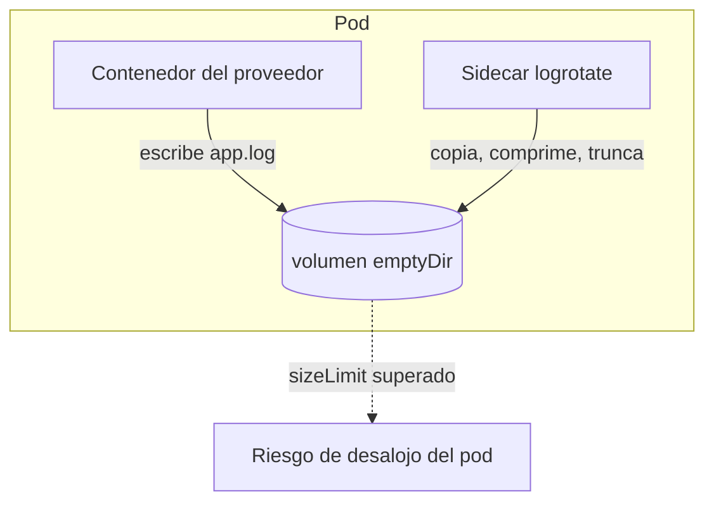

Tuve que desplegar una aplicación de terceros en un pod. Ésta escribía sus logs en archivos dentro de su propio directorio y nunca los rotaba. No tenía control sobre la imagen del contenedor, por lo que no podía modificar su mecanismo de logging. Los archivos de logs crecieron progresivamente hasta llenar el disco del nodo.

Este artículo recorre el patrón que permite contener esta situación: un pequeño contenedor sidecar que ejecuta `logrotate` sobre un volumen compartido, planificado mediante `crond`, junto con un límite de tamaño (`sizeLimit`) en ese volumen como red de seguridad. Todo ello sin modificar la imagen provista por el proveedor.

Mi clúster ejecuta Kubernetes 1.32.x, por lo que los manifiestos mostrados a continuación utilizan un segundo contenedor convencional, compatible con cualquier versión. También analizo dos modos de fallo que pasan desapercibidos y cómo actualizar la política de rotación más adelante sin necesidad de reiniciar recursos.

---

## Por qué el mecanismo habitual no ayuda

El `kubelet` ya rota los logs de los contenedores, pero únicamente aquellos emitidos hacia los flujos `stdout` y `stderr` gestionados por el runtime (los archivos capturados en `/var/log/pods` que se consultan mediante `kubectl logs`). Dos parámetros del `kubelet` regulan dicha rotación: `containerLogMaxSize` (por defecto, 10 Mi) y `containerLogMaxFiles` (por defecto, 5).

Una aplicación que escribe directamente en sus propios archivos de registro elude todo este mecanismo. Dichos archivos residen en la capa de escritura del contenedor (`writable layer`) o en un volumen montado, y el `kubelet` no los gestiona de manera activa. Crecen de forma continua hasta agotar el espacio en disco, momento en el que el `kubelet` desaloja pods ante la presión de almacenamiento (`disk pressure`); con umbrales estrictos de desalojo (`hard eviction`), la terminación del pod es inmediata y sin período de gracia (`terminationGracePeriodSeconds: 0`).

Por tanto, la solución debe aplicarse en el lugar exacto donde residen los archivos.



## Opciones sobre la mesa

| Opción | Problema |
| --- | --- |
| Modificar la imagen o añadir un wrapper de inicio | Inviable: la imagen de terceros no está bajo nuestro control |
| Solicitar al proveedor soporte para rotación | Factible, pero sujeto a los tiempos de respuesta y al ciclo de releases del proveedor, sin un plazo garantizado |
| Configurar la aplicación para emitir logs hacia `stdout` | Depende estrictamente de las capacidades de configuración que ofrezca el proveedor |
| Sidecar de streaming (`tail` del archivo hacia el `stdout` del sidecar) | Funciona, pero duplica el almacenamiento ocupado en el nodo y el archivo de origen sigue creciendo a menos que se trunque manualmente |
| **Sidecar con `logrotate` sobre el volumen compartido** | Rota el archivo in situ; la aplicación continúa escribiendo en el mismo descriptor sin interrupciones |

La [documentación oficial de logging de Kubernetes](https://kubernetes.io/docs/concepts/cluster-administration/logging/) describe con precisión este enfoque: «sidecar containers can also be used to rotate log files that cannot be rotated by the application itself», señalando como ejemplo un contenedor auxiliar que ejecuta `logrotate` periódicamente.

## El patrón

La arquitectura consta de tres piezas: un volumen `emptyDir` compartido, el contenedor del proveedor que lo monta en la ruta donde escribe la aplicación, y un sidecar que ejecuta `logrotate` sobre ese mismo volumen según una planificación periódica.

### La imagen del sidecar

La imagen del proveedor es inmutable, pero la del sidecar está bajo tu control. Ésta se basa en Alpine con el paquete `logrotate`, complementada con un entrypoint mínimo que registra la planificación en cron e inicia `crond` en primer plano:

**Dockerfile**

```dockerfile
FROM alpine:3.24

RUN apk add --no-cache logrotate

COPY entrypoint.sh /entrypoint.sh
RUN chmod +x /entrypoint.sh

CMD ["/entrypoint.sh"]
```

**entrypoint.sh**

```sh
#!/bin/sh
set -e

CRON_SCHEDULE="${LOGROTATE_CRON:-*/10 * * * *}"

echo "Starting logrotate sidecar..."
echo "${CRON_SCHEDULE} /usr/sbin/logrotate /config/logrotate.conf" > /etc/crontabs/root

exec crond -f
```

El binario `crond` de BusyBox lee las tablas de cron en `/etc/crontabs/<usuario>`, por lo que escribir el archivo antes de invocar `exec crond -f` es toda la configuración requerida. Un bucle convencional como `while : ; do logrotate ...; sleep 600; done` funcionaría de forma idéntica; el uso de cron únicamente aporta una sintaxis de temporización más conocida y estructurada.

Presta atención a la ruta: `logrotate` lee su configuración desde `/config/logrotate.conf`, en lugar del clásico `/etc/logrotate.conf`. La sección sobre montajes de `ConfigMap` expuesta más adelante detalla la razón técnica.

> [!NOTE]
> Compila esta imagen tú mismo, fija una versión estable y soportada de Alpine (v3.24 es la rama estable actual; verifica [alpinelinux.org/releases](https://alpinelinux.org/releases/)) o un digest inmutable, y analízala con escáneres de seguridad como cualquier otra imagen de producción. Descargar e instalar paquetes durante el arranque del contenedor es aceptable en un laboratorio, pero desaconsejable en un nodo productivo. Asimismo, BusyBox por sí solo no basta: su binario incluye `crond`, pero carece del applet de `logrotate`, razón por la cual el Dockerfile instala el paquete correspondiente.

### El despliegue

```yaml
apiVersion: apps/v1
kind: Deployment
metadata:
  name: vendor-app
spec:
  replicas: 1
  selector:
    matchLabels:
      app: vendor-app
  template:
    metadata:
      labels:
        app: vendor-app
    spec:
      containers:
        - name: vendor-app
          image: registry.example.com/vendor/app:1.2.3   # no es tuya para cambiarla
          volumeMounts:
            - name: applogs
              mountPath: /var/log/vendor-app   # dondequiera que la app del proveedor escriba
          resources:
            requests:
              ephemeral-storage: 100Mi
            limits:
              ephemeral-storage: 500Mi
        - name: logrotate
          image: registry.example.com/platform/logrotate-sidecar:1.0.0   # tu imagen, construida arriba
          env:
            - name: LOGROTATE_CRON
              value: "*/10 * * * *"
          volumeMounts:
            - name: applogs
              mountPath: /var/log/vendor-app
            - name: logrotate-config
              mountPath: /config
          resources:
            requests:
              ephemeral-storage: 10Mi
            limits:
              ephemeral-storage: 50Mi
      volumes:
        - name: applogs
          emptyDir:
            sizeLimit: 500Mi   # red de seguridad, tomada del almacenamiento efímero del nodo
        - name: logrotate-config
          configMap:
            name: logrotate-config
```

Los nombres de recursos e imágenes han sido anonimizados; la estructura es la implementada en producción.

El sidecar monta el `ConfigMap` como **directorio** en `/config`, sin utilizar `subPath`. Ésta es la decisión clave que permite modificar la política de rotación en caliente sin reiniciar el pod. Evita montarlo directamente sobre `/etc`: cualquier volumen montado sobre un directorio preexistente en la imagen oculta su contenido previo.

Desde Kubernetes v1.29 es posible declarar el sidecar como un sidecar nativo (un contenedor en `initContainers` con `restartPolicy: Always`), lo que asegura que inicie antes que la aplicación principal y mejore la integración en recursos de tipo `Job`; esta funcionalidad está habilitada por defecto desde v1.29 y es estable desde v1.33. En Kubernetes 1.32, un contenedor complementario convencional como el expuesto anteriormente es una alternativa perfectamente válida. Migrar hacia la modalidad nativa requiere un cambio mínimo en este manifiesto: dado que solo define `image`, `env`, `resources` y `volumeMounts` (todos campos admitidos en un contenedor de inicialización, sin necesidad de adaptar `ports` ni `probes`), basta con trasladar el bloque bajo `initContainers` asignando `restartPolicy: Always`, manteniendo idénticos la imagen, el `ConfigMap` y los volúmenes.

### La configuración de logrotate

```yaml
apiVersion: v1
kind: ConfigMap
metadata:
  name: logrotate-config
data:
  logrotate.conf: |
    su root root
    /var/log/vendor-app/*.log {
        size 100M
        rotate 3
        compress
        missingok
        notifempty
        copytruncate
    }
```

- `size 100M` establece un umbral de evaluación en cada ciclo: cuando `logrotate` se ejecuta y el archivo ha superado los 100 MB, procede a rotarlo. Actúa como disparador y no como tope rígido: el archivo puede continuar creciendo más allá de 100 MB en el intervalo entre ejecuciones.
- `rotate 3` conserva tres generaciones comprimidas.
- `copytruncate` es el mecanismo esencial para aplicaciones que carecen de soporte para reabrir descriptores de archivo (como ante una señal `SIGHUP`). En lugar de renombrar el archivo en el sistema de ficheros, `logrotate` realiza una copia del contenido y luego trunca el original a cero bytes in situ, lo que permite que el proceso continúe escribiendo en el descriptor de archivo abierto sin interrupciones.
- `su root root` fuerza la rotación bajo dicho usuario y grupo en lugar de los valores por defecto. Dado que `crond` ya se ejecuta como root, la identidad efectiva no varía, pero la directiva no es superflua: sin una cláusula `su`, si `logrotate` corre como root aborta la ejecución con un error si el directorio de logs posee permisos de escritura universal (`world-writable`) o de grupo ajeno a root (mecanismo de defensa interno contra escalada de privilegios y symlinks maliciosos). Cualquier especificación explícita de `su` elude dicha comprobación de seguridad; por tanto, conviene definir los privilegios mínimos necesarios (`least privilege`) para leer y escribir en ese directorio. Verifica la propiedad y los permisos reales del directorio antes de desplegar en producción.

> [!WARNING]
> La directiva `copytruncate` conlleva una contrapartida técnica. La página de manual de `logrotate` advierte expresamente de que «there is a very small time slice between copying the file and truncating it, so some logging data might be lost». Determinar si esta pérdida potencial es tolerable depende de los requerimientos de tu carga de trabajo; en registros de auditoría o transacciones financieras, resulta inaceptable. Asimismo, considera que la fase de copia duplica momentáneamente el espacio ocupado por el log activo en el volumen: dimensiona el almacenamiento con margen suficiente para el log activo más voluminoso, sus generaciones retenidas y una copia completa adicional durante la rotación.

Criterios para dimensionar el `sizeLimit`: se trata de una cota que debes definir según tu entorno; ninguna guía técnica puede fijar una cifra absoluta por ti. Una generación rotada puede exceder el parámetro `size` en la cantidad exacta que la aplicación escriba entre dos intervalos de cron. Por consiguiente, para cada archivo `*.log` monitorizado, el volumen debe soportar: el tamaño máximo que puede alcanzar el archivo activo antes de activar la rotación (`size` más el pico de escritura intermedio), `rotate` generaciones calculadas a ese tamaño tope (estimadas sin comprimir por prudencia, ya que la compresión consume espacio transitorio durante su ejecución) y una copia completa adicional del archivo mientras opera `copytruncate`. El valor `sizeLimit: 500Mi` indicado anteriormente resulta coherente para un único archivo de log con `size 100M`, `rotate 3` y una tasa de emisión moderada; mide la tasa real de escritura, contabiliza el número de archivos y añade margen antes de adoptar una cifra definitiva. Recuerda que el cómputo de recursos es compartido: el `kubelet` contabiliza este volumen dentro del almacenamiento efímero (`ephemeral-storage`) del pod junto con las capas de escritura de los contenedores y los propios logs del pod.

---

## Cambiar la política más adelante: opciones de montaje del ConfigMap

Eventualmente requerirás ajustar `size` o `rotate`. La dinámica de actualización depende por completo del modo en que el `ConfigMap` se proyecta dentro del contenedor. Éstas son las tres alternativas con sus implicaciones:

**Montaje como directorio (estrategia utilizada en este despliegue).** El `ConfigMap` se monta como directorio en `/config` y `logrotate` procesa `/config/logrotate.conf`. Al actualizar el `ConfigMap`, Kubernetes sincroniza automáticamente el nuevo contenido en el volumen proyectado. Este proceso no es instantáneo: la latencia total equivale al período de sincronización del `kubelet` más el tiempo de propagación de la caché del API server (que mediante la caché estándar basada en `watch` suele oscilar entre unos segundos y un par de minutos). A partir de ese instante, la siguiente ejecución temporizada por cron invoca un proceso nuevo de `logrotate` que lee la configuración actualizada, sin reinicios del pod ni ejecuciones de `rollout`. Solo los archivos proyectados se actualizan de este modo: la temporización en sí, regulada por la variable de entorno `LOGROTATE_CRON`, exige recrear el pod si se desea modificar.

**Montaje como archivo individual mediante `subPath`.** Montar una clave específica deposita el archivo exactamente en rutas fijas como `/etc/logrotate.conf`, requeridas por ciertas utilidades. La desventaja, descrita en la [documentación de ConfigMaps de Kubernetes](https://kubernetes.io/docs/concepts/configuration/configmap/), es que los contenedores que consumen un `ConfigMap` mediante montajes `subPath` no reciben actualizaciones en caliente. El pod en ejecución mantendrá la política anterior hasta ser recreado explícitamente.

**Anotación de checksum con Helm (en despliegues orquestados por charts).** Si el `Deployment` y el `ConfigMap` son generados mediante un chart de Helm, existe un patrón común: incorporar en el `pod template` una anotación que contenga el hash SHA-256 del contenido renderizado del `ConfigMap`. Un comando `helm upgrade` que altere la política modificará el checksum, mutando la plantilla del pod y desencadenando un `rollout` automático; de este modo, los nuevos pods iniciarán con la configuración vigente incluso si se emplea `subPath`. Esta aproximación presenta dos consideraciones: el `rollout` sustituye el pod íntegro (aplicación principal y sidecar), por lo que los logs contenidos en el volumen `emptyDir` no viajan con el pod nuevo; adicionalmente, modificar el `ConfigMap` manualmente no recalcula el checksum, y una posterior ejecución de `helm upgrade` sobreescribirá los cambios manuales. Mantén siempre una única fuente de verdad. El patrón se documenta en la [guía de trucos de Helm](https://helm.sh/docs/howto/charts_tips_and_tricks/#automatically-roll-deployments); este despliegue no recurre a Helm, por lo que no se incluye dicha plantilla.

Independientemente del modo de montaje, un error de sintaxis en el archivo de configuración provocará que la siguiente ejecución de `logrotate` falle silenciosamente. La práctica operativa más fiable consiste en auditar el volumen en busca de nuevas generaciones comprimidas y marcas de tiempo recientes, y no confiar únicamente en el estado `Running` del pod.

---

## Dos formas en que este patrón falla en silencio

Durante la revisión y prueba local de este patrón en entornos reales, surgieron dos modos de fallo que no generan alertas inmediatas ni errores explícitos.

### `-f` convierte de forma inadvertida la rotación por tamaño en rotación por tiempo

En el despliegue examinado se ejecutaba `logrotate -f /etc/logrotate.conf`. El parámetro `-f` (`--force`) instruye a `logrotate` a «rotar incluso si ninguna condición lo exige». Pruebas locales sobre la configuración precedente (`size 100M`) con `logrotate` 3.19.0 confirmaron este comportamiento: un archivo de log de apenas 13 bytes se rotó inmediatamente al invocar `-f`, si bien la directiva `notifempty` continuó omitiendo archivos vacíos. En una configuración con ejecuciones cada diez minutos y `rotate 10`, dicho flag retiene únicamente los últimos 100 minutos de registro (asumiendo ejecuciones exitosas continuas), en lugar de diez segmentos de 100 MB. Ambos esquemas son válidos, pero responden a arquitecturas distintas: retención por volumen frente a retención temporal. Prescindir de `-f` restituye a cron su función adecuada de cadencia de muestreo: el cronjob determina la frecuencia de inspección, no la decisión de rotar.

### Un volumen sin restricciones y un límite de tamaño reactivo

Aquel despliegue inicial utilizaba un volumen no acotado `emptyDir: {}`. La rotación gestiona los archivos contemplados, pero si el proceso sidecar se detiene o la aplicación genera archivos no capturados por la máscara (el patrón solo abarca `*.log`), el volumen crecerá indefinidamente. Definir `sizeLimit` junto con declaraciones de `requests` y `limits` para `ephemeral-storage` acota el fallo: el `kubelet` monitoriza el consumo de almacenamiento efímero del pod y desaloja las cargas que sobrepasan sus asignaciones. Conviene ser rigurosos con el comportamiento interno: el `kubelet` evalúa el consumo en intervalos de mantenimiento periódicos (`housekeeping-interval`, por defecto cada 10 s), el desalojo es una acción reactiva y otros pods, capas de contenedores e imágenes base comparten el mismo sistema de ficheros del nodo. El parámetro `sizeLimit` acota la capacidad máxima asignada al pod; opera como red de contención, no como salvaguarda absoluta frente a la saturación del disco del nodo. Inspecciona periódicamente los archivos generados mediante `kubectl exec deploy/vendor-app -- ls -la /var/log/vendor-app`, ampliando la máscara de búsqueda si la aplicación genera extensiones adicionales.

Dos observaciones complementarias: en primer lugar, `logrotate` gestiona un archivo de estado sobre el que adquiere un bloqueo exclusivo (`lock`); la documentación oficial establece `/var/lib/logrotate.status` como ruta estándar (sujeta a variaciones según la distribución) y `/dev/null` como alternativa para deshabilitar el guardado de estado. Aunque bajo este diseño cada ejecución de cron es independiente, una ruta de estado sin permisos de escritura abortará la ejecución, manifestándose en los logs del sidecar. En segundo lugar, la verificación empírica de funcionamiento radica en la presencia regular de nuevos archivos `.gz` con marcas de tiempo actualizadas en el volumen compartido.

---

## Pruébalo en un laboratorio antes de producción

Es aconsejable validar esta arquitectura en un clúster local desechable (`kind` o `minikube`) antes de implementarla en producción:

1. Sustituye el contenedor del proveedor por un generador de registros sintéticos para observar la rotación en pocos minutos; por ejemplo, un contenedor BusyBox que ejecute `sh -c 'while : ; do dd if=/dev/zero bs=1024 count=1 2>/dev/null | tr '\0' 'x' >> /var/log/vendor-app/app.log; usleep 100000; done'`. Este comando genera una tasa aproximada de 10 KB/s, permitiendo observar rotaciones continuas si se configura un umbral bajo.
2. Reduce la directiva `size` temporalmente (por ejemplo, `size 1M`) para no demorar la prueba hasta alcanzar 100 MB.
3. Inspecciona el contenido del volumen compartido: `kubectl exec deploy/vendor-app -c logrotate -- ls -lh /var/log/vendor-app`. Comprobarás cómo `app.log` se trunca a cero bytes y se generan los correspondientes archivos comprimidos.
4. Para validar la ejecución programada de cron en ciclo corto, define `LOGROTATE_CRON` con el valor `* * * * *` en el laboratorio para forzar ejecuciones por minuto.
5. Para verificar la propagación dinámica de cambios en el `ConfigMap`, modifícalo con `kubectl edit configmap logrotate-config`, reduce nuevamente el parámetro `size` y aguarda: una vez que Kubernetes actualice la proyección del volumen, la siguiente iteración de cron aplicará la nueva política sin reiniciar el pod.
6. Para comprobar el mecanismo de `sizeLimit`, establece un valor reducido (como `sizeLimit: 20Mi`), suprime el retardo `usleep` en el generador para saturar el volumen rápidamente y monitoriza con `kubectl get pod -w`. El desalojo es reactivo y no instantáneo: el `kubelet` computa el almacenamiento en su ciclo de mantenimiento (por defecto cada 10 s), de modo que el pod pasará a estado `Evicted` instantes después de rebasar la cuota. La ejecución de `kubectl describe pod` reflejará el motivo asociado a `ephemeral-storage` y `kubectl get events` registrará el evento de desalojo correspondiente.

> [!NOTE]
> El comportamiento de `logrotate` documentado en este artículo fue validado localmente sobre Linux con la versión 3.19.0: ausencia de rotación bajo el umbral de tamaño sin `-f`; rotación inmediata de un archivo de 13 bytes al emplear `-f`; omisión de archivos vacíos incluso con `-f` gracias a `notifempty`; truncamiento efectivo del archivo original a cero bytes preservando la totalidad del registro en el bloque comprimido mediante `copytruncate`; y retención matemática del número exacto de generaciones configuradas. Los manifiestos de Kubernetes y los pasos del laboratorio descritos constituyen una guía de implementación de referencia que debe ser validada en tu entorno operativo.

---

## Lo que este patrón no hace

- **No sustituye al transporte centralizado de logs (`log shipping`).** La rotación previene la saturación del almacenamiento local; no exporta los registros hacia plataformas de observabilidad centralizada. Si requieres indexación y retención duradera, implementa un agente de logging (mediante un sidecar especializado o un daemon a nivel de nodo, según describe la [documentación oficial](https://kubernetes.io/docs/concepts/cluster-administration/logging/)) manteniendo la rotación como mecanismo de contención del almacenamiento local. Presta atención a esta interacción: un agente que lee el archivo en tiempo real (`tail`) mientras opera `copytruncate` puede perder las líneas escritas durante la ventana entre la copia y el truncamiento.
- **No persiste tras la eliminación del pod.** Los datos alojados en un volumen `emptyDir` se destruyen permanentemente cuando el pod finaliza su ciclo de vida en el nodo.
- **No mitiga incrementos abruptos dentro del intervalo de muestreo.** Un pico masivo de escritura puede saturar el volumen antes de la siguiente ejecución de cron; el parámetro `sizeLimit` acota el radio de impacto (`blast radius`), evitando que afecte a otros recursos del nodo.
- **Puede perder algunas líneas en cada rotación**, debido a la ventana inherente a la operación de `copytruncate`.

---

## Glosario

- **Sidecar**: contenedor secundario integrado dentro del mismo pod para complementar o extender las funciones del contenedor principal. La modalidad nativa, implementada como un contenedor `init` con `restartPolicy: Always`, está activa por defecto desde Kubernetes v1.29 y es estable desde v1.33; un contenedor secundario estándar es compatible con cualquier versión de Kubernetes.
- **crond**: demonio del servicio cron. Alpine incorpora la implementación de BusyBox, la cual gestiona las tablas de planificación de usuarios en `/etc/crontabs/`.
- **emptyDir**: volumen efímero que se crea vacío al vincular un pod a un nodo, compartido por todos los contenedores de dicho pod y destruido definitivamente al finalizar el pod.
- **Almacenamiento efímero (`ephemeral-storage`)**: espacio en el disco local del nodo consumido por las capas de escritura de los contenedores, los volúmenes `emptyDir` y los registros de log del pod. El `kubelet` computa este consumo y aplica el desalojo si se exceden los límites declarados. Para mayor detalle, consulta [Almacenamiento efímero en Kubernetes](/es/docs/observability/ephemeral-storage).
- **Desalojo (`eviction`)**: mecanismo reactivo mediante el cual el `kubelet` termina la ejecución de pods para reclamar recursos locales del nodo, como ante episodios de presión de almacenamiento (`disk pressure`).
- **copytruncate**: directiva de `logrotate` que duplica el archivo activo y posteriormente trunca el archivo original a cero bytes, concebida para aplicaciones que no admiten el cierre y reapertura dinámica de sus descriptores de log.
- **ConfigMap**: recurso de Kubernetes diseñado para almacenar pares clave-valor de configuración desacoplados del código, proyectable como archivos dentro de un volumen o expuesto mediante variables de entorno.
- **subPath**: mecanismo de montaje de volúmenes que proyecta un archivo o subdirectorio específico en lugar del volumen íntegro; los volúmenes proyectados mediante `subPath` no reciben actualizaciones dinámicas en caliente.

---

## Resumen

- Una aplicación de terceros que emite registros en archivos locales requiere gestión de rotación en el propio volumen donde residen: un sidecar con `logrotate` sobre un `emptyDir` compartido contiene el problema sin alterar la imagen del proveedor.
- Proyectar el `ConfigMap` como directorio garantiza que las actualizaciones de política se sincronicen automáticamente en el volumen, siendo adoptadas en la siguiente iteración de cron sin requerir reinicios del pod. Los montajes con `subPath` impiden actualizaciones en caliente y el hash de Helm fuerza un `rollout` completo.
- El parámetro `size` condiciona la rotación al volumen alcanzado; la inclusión de `-f` la transmuta en una política basada en tiempo. Define con claridad el modelo requerido.
- Declarar `sizeLimit` y límites de `ephemeral-storage` confina posibles anomalías del sidecar a un alcance predecible, con el desalojo reactivo como salvaguarda del nodo.
- Valida la operativa en un clúster de pruebas: el indicador fiable del sistema es la aparición regular de generaciones comprimidas con marcas de tiempo recientes en el volumen compartido.

## Referencias

- [Kubernetes: Logging Architecture](https://kubernetes.io/docs/concepts/cluster-administration/logging/)
- [Kubernetes: Sidecar Containers](https://kubernetes.io/docs/concepts/workloads/pods/sidecar-containers/)
- [Kubernetes: Volumes (emptyDir)](https://kubernetes.io/docs/concepts/storage/volumes/#emptydir)
- [Kubernetes: Resource Management for Pods and Containers](https://kubernetes.io/docs/concepts/configuration/manage-resources-containers/)
- [Kubernetes: ConfigMaps (los ConfigMaps montados se actualizan automáticamente; los montajes `subPath` no)](https://kubernetes.io/docs/concepts/configuration/configmap/)
- [Kubernetes: Node-pressure Eviction](https://kubernetes.io/docs/concepts/scheduling-eviction/node-pressure-eviction/)
- [Kubernetes: Images (imagePullPolicy)](https://kubernetes.io/docs/concepts/containers/images/)
- [Helm: Automatically roll deployments (anotación checksum)](https://helm.sh/docs/howto/charts_tips_and_tricks/#automatically-roll-deployments)
- [Página de manual de logrotate(8)](https://man7.org/linux/man-pages/man8/logrotate.8.html)
- [Código fuente de logrotate, tag 3.19.0 (comprobación de permisos para root sin `su`)](https://github.com/logrotate/logrotate/blob/3.19.0/logrotate.c)
- [Releases de Alpine Linux](https://alpinelinux.org/releases/)
