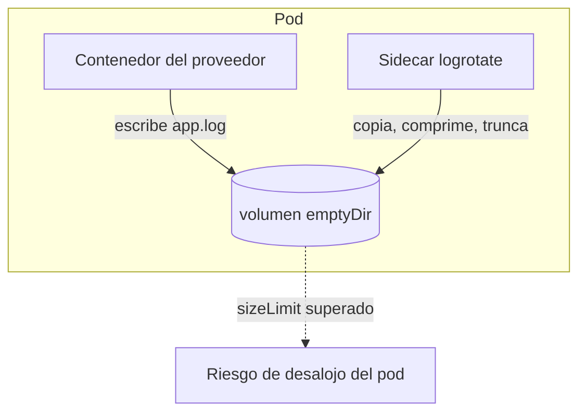

Tuve que desplegar una aplicación de un tercero como un pod. Escribía sus logs en archivos, dentro de su propio directorio, y nunca los rotaba. No tenía control sobre la imagen, así que no podía cambiar cómo registraba. Los logs crecieron hasta llenar el disco.

Este artículo recorre el patrón que lo contiene: un pequeño contenedor sidecar ejecutando `logrotate` sobre un volumen compartido, programado por `crond`, más un límite de tamaño en ese volumen como red de seguridad. Todo sin tocar la imagen del proveedor.

Mi clúster ejecuta Kubernetes 1.32.x, así que los manifiestos de abajo usan un segundo contenedor normal, que funciona en cualquier versión. También cubro dos modos de fallo que permanecen silenciosos y cómo cambiar la política de rotación más adelante sin reiniciar nada.

---

## Por qué el mecanismo habitual no ayuda

El kubelet ya rota los logs de los contenedores, pero solo los escritos en los flujos `stdout` y `stderr` del contenedor, los archivos que lees con `kubectl logs`. Dos ajustes del kubelet controlan esa rotación: `containerLogMaxSize` (10 Mi por defecto) y `containerLogMaxFiles` (5 por defecto).

Una aplicación que escribe en sus propios archivos de log se salta todo eso. Esos archivos viven en la capa escribible del contenedor o en un volumen montado, y el kubelet no los gestiona. Crecen hasta llenar el disco, y en un nodo bajo presión de disco el kubelet desaloja pods; con umbrales duros de desalojo el apagado es inmediato, sin periodo de gracia.

Así que la solución tiene que ocurrir donde están los archivos.



## Opciones sobre la mesa

| Opción | Problema |
| --- | --- |
| Arreglar la imagen o añadir un wrapper de arranque | Imposible: la imagen no es mía |
| Pedir al proveedor opciones de log | Posible, pero depende del soporte y del ciclo de releases del proveedor, sin plazo garantizado |
| Configurar la app para loguear a `stdout` | Depende por completo de lo que permita la configuración del proveedor |
| Sidecar de streaming (`tail` del archivo al `stdout` del sidecar) | Funciona, pero añade una segunda copia de esos logs en el nodo, y el archivo original sigue creciendo salvo que también lo trunques |
| **Sidecar logrotate sobre el volumen compartido** | Rota el archivo en su sitio; la app sigue escribiendo en el mismo archivo |

La [documentación oficial de logging de Kubernetes](https://kubernetes.io/docs/concepts/cluster-administration/logging/) nombra exactamente este enfoque: "sidecar containers can also be used to rotate log files that cannot be rotated by the application itself", con un pequeño contenedor ejecutando `logrotate` periódicamente como ejemplo.

## El patrón

Tres piezas: un volumen `emptyDir` compartido, el contenedor del proveedor montándolo donde la app escribe, y un sidecar ejecutando `logrotate` contra ese mismo volumen con una programación.

### La imagen del sidecar

La imagen del proveedor es intocable, pero la del sidecar es tuya. Esta es Alpine con el paquete `logrotate`, más un pequeño entrypoint que registra una programación cron y arranca `crond` en primer plano:

**Dockerfile**

```dockerfile
FROM alpine:3.24

RUN apk add --no-cache logrotate

COPY entrypoint.sh /entrypoint.sh
RUN chmod +x /entrypoint.sh

CMD ["/entrypoint.sh"]
```

**entrypoint.sh**

```sh
#!/bin/sh
set -e

CRON_SCHEDULE="${LOGROTATE_CRON:-*/10 * * * *}"

echo "Starting logrotate sidecar..."
echo "${CRON_SCHEDULE} /usr/sbin/logrotate /config/logrotate.conf" > /etc/crontabs/root

exec crond -f
```

El `crond` de BusyBox lee sus crontabs de `/etc/crontabs/<usuario>`, así que escribir el archivo antes de `exec crond -f` es todo el cableado que necesita. Un simple bucle `while : ; do logrotate ...; sleep 600; done` funciona igual de bien; cron solo te da una sintaxis de programación conocida.

Fíjate en la ruta: logrotate lee su configuración de `/config/logrotate.conf`, no del clásico `/etc/logrotate.conf`. La sección sobre montajes de ConfigMap más abajo explica por qué.

> [!NOTE]
> Construye esta imagen tú mismo, fija una versión de Alpine soportada (v3.24 es la rama estable actual en el momento de escribir esto; consulta [alpinelinux.org/releases](https://alpinelinux.org/releases/)) o un digest, y escanéala como cualquier otra imagen que ejecutes. Descargar e instalar paquetes al arrancar el contenedor vale para un laboratorio, no para un nodo que te importe. BusyBox por sí solo tampoco basta: su binario incluye `crond` pero ningún applet `logrotate`, y por eso el Dockerfile instala el paquete.

### El despliegue

```yaml
apiVersion: apps/v1
kind: Deployment
metadata:
  name: vendor-app
spec:
  replicas: 1
  selector:
    matchLabels:
      app: vendor-app
  template:
    metadata:
      labels:
        app: vendor-app
    spec:
      containers:
        - name: vendor-app
          image: registry.example.com/vendor/app:1.2.3   # no es tuya para cambiarla
          volumeMounts:
            - name: applogs
              mountPath: /var/log/vendor-app   # dondequiera que la app del proveedor escriba
          resources:
            requests:
              ephemeral-storage: 100Mi
            limits:
              ephemeral-storage: 500Mi
        - name: logrotate
          image: registry.example.com/platform/logrotate-sidecar:1.0.0   # tu imagen, construida arriba
          env:
            - name: LOGROTATE_CRON
              value: "*/10 * * * *"
          volumeMounts:
            - name: applogs
              mountPath: /var/log/vendor-app
            - name: logrotate-config
              mountPath: /config
          resources:
            requests:
              ephemeral-storage: 10Mi
            limits:
              ephemeral-storage: 50Mi
      volumes:
        - name: applogs
          emptyDir:
            sizeLimit: 500Mi   # red de seguridad, tomada del almacenamiento efímero del nodo
        - name: logrotate-config
          configMap:
            name: logrotate-config
```

Los nombres y las imágenes están anonimizados; la forma es la que corre en producción.

El sidecar monta el ConfigMap como **directorio** en `/config`, sin `subPath`. Esa única decisión es la que permite cambiar la política de rotación más adelante sin reiniciar el pod. No lo montes encima de `/etc`: un volumen montado sobre un directorio existente oculta su contenido.

Desde Kubernetes v1.29 puedes definir en su lugar el sidecar como sidecar nativo (un contenedor init con `restartPolicy: Always`), lo que garantiza que arranca antes que la app y funciona mejor con jobs; la funcionalidad está activa por defecto desde v1.29 y es estable desde v1.33. En 1.32 un contenedor normal como el de arriba es una opción perfectamente buena. Migrar a la forma nativa más adelante es un cambio pequeño para este contenedor concreto: solo define `image`, `env`, `resources` y `volumeMounts`, todos campos válidos en un contenedor init, sin `ports` ni `probes` que traducir, así que el contenedor pasa a `initContainers` con `restartPolicy: Always` y la imagen, el ConfigMap y los volúmenes se quedan igual.

### La configuración de logrotate

```yaml
apiVersion: v1
kind: ConfigMap
metadata:
  name: logrotate-config
data:
  logrotate.conf: |
    su root root
    /var/log/vendor-app/*.log {
        size 100M
        rotate 3
        compress
        missingok
        notifempty
        copytruncate
    }
```

- `size 100M` es un umbral que se comprueba en cada ejecución: cuando logrotate corre y el archivo ha superado los 100 MB, lo rota. Un disparador, no un tope: el archivo puede crecer más de 100 MB entre ejecuciones.
- `rotate 3` conserva tres generaciones comprimidas.
- `copytruncate` es la clave para una aplicación sin un mecanismo usable para reabrir su archivo de log. En vez de renombrar el archivo, logrotate lo copia y luego trunca el original a cero, y la aplicación sigue escribiendo en el mismo descriptor de archivo.
- `su root root` rota como ese usuario y grupo en lugar del predeterminado. Con `crond` corriendo ya como root la identidad es la misma, pero la línea no es decorativa: sin ninguna directiva `su`, logrotate corriendo como root omite la rotación con un error cuando el directorio de logs es escribible por todos, o escribible por grupo con un grupo distinto de root. Cualquier `su` explícito se salta esa comprobación de permisos del directorio, así que elige el valor para reducir privilegios, no para satisfacer la comprobación: el usuario y grupo con menos privilegios que puedan leer y escribir esos logs. Verifica el propietario y los permisos reales del directorio de logs antes de producción.

> [!WARNING]
> `copytruncate` tiene un coste. La página de manual de logrotate advierte de que "there is a very small time slice between copying the file and truncating it, so some logging data might be lost." Que sea aceptable depende de lo que valgan esos logs para ti; para logs de auditoría, no lo es. Ten en cuenta también que el paso de copia duplica brevemente el espacio que ocupa el log activo en el volumen: dimensiona el volumen con margen para el log activo más grande, sus generaciones retenidas y una copia completa extra durante la rotación.

Cómo pensar el `sizeLimit`: es un límite que eliges tú, y ningún artículo puede validarte un número. Una generación rotada puede superar `size` en lo que la aplicación escriba entre dos ejecuciones del cron, así que por cada archivo `*.log` que cubra el patrón, el volumen tiene que alojar: lo máximo que un log activo puede alcanzar antes de que se dispare la rotación (`size` más el pico de crecimiento entre ejecuciones), `rotate` generaciones a ese mismo tamaño máximo (contadas sin comprimir para ir seguro; comprimirlas también ocupa espacio transitorio mientras corre), y una copia completa extra de ese log más grande mientras `copytruncate` trabaja. El `sizeLimit: 500Mi` de arriba es coherente con un único archivo de log, `size 100M`, `rotate 3` y un crecimiento modesto entre ejecuciones; mide la tasa real de escritura, cuenta los archivos de log y añade margen antes de fiarte de cualquier número. Recuerda que la contabilidad es compartida: el kubelet cuenta este volumen dentro del almacenamiento efímero del pod junto con las capas escribibles de los contenedores y los logs del propio pod.

---

## Cambiar la política más adelante: opciones de montaje del ConfigMap

Tarde o temprano querrás ajustar `size` o `rotate`. Lo que pasa después depende por completo de cómo llega el ConfigMap al contenedor. Estas son las tres opciones, con sus diferencias.

**Montaje como directorio (lo que usa este despliegue).** El ConfigMap se monta como directorio en `/config` y logrotate lee `/config/logrotate.conf`. Cuando editas el ConfigMap, Kubernetes proyecta el nuevo contenido en el volumen automáticamente. No es instantáneo: el retraso total puede llegar hasta el periodo de sincronización del kubelet más el retraso de propagación de la caché, y con la caché por defecto basada en watch suele ser de segundos a un par de minutos. A partir de ese momento, la siguiente ejecución del cron lee el archivo nuevo, porque cada ejecución es un proceso logrotate nuevo. Sin reinicio de pod, sin rollout. Solo se propagan así los contenidos de los archivos: la programación en sí, `LOGROTATE_CRON`, es una variable de entorno y sigue requiriendo recrear el pod para cambiarla.

**Montaje como archivo con `subPath`.** Montar la clave como archivo la deja exactamente en una ruta como `/etc/logrotate.conf`, que algunos montajes esperan. El precio, directo de la [documentación de ConfigMaps de Kubernetes](https://kubernetes.io/docs/concepts/configuration/configmap/): un contenedor que usa un ConfigMap como montaje de volumen `subPath` no recibe actualizaciones del ConfigMap. El pod en ejecución mantiene la política vieja hasta que lo recreas.

**Anotación checksum de Helm (solo si un chart renderiza esto).** Si el Deployment y el ConfigMap vienen de un chart de Helm, hay un tercer patrón: añadir al pod template una anotación con el SHA-256 del ConfigMap renderizado. Un `helm upgrade` que cambie la política cambia el checksum, lo que cambia el pod template, lo que dispara un rollout, así que los pods nuevos arrancan con la política nueva incluso cuando el archivo está montado con `subPath`. Dos costes que sopesar: el rollout reemplaza el pod entero (aplicación y sidecar) y los logs del `emptyDir` no pasan al pod nuevo; y nada recalcula el checksum cuando editas el ConfigMap a mano, mientras que un `helm upgrade` posterior re-renderiza desde el chart y puede sobrescribir ediciones manuales. Elige una única fuente de verdad para el archivo. El patrón está documentado en la [página de consejos y trucos de Helm](https://helm.sh/docs/howto/charts_tips_and_tricks/#automatically-roll-deployments); este despliegue no usa Helm, así que no hay chart que mostrar.

Sea cual sea el montaje, una edición rota hace fallar la siguiente ejecución de logrotate en silencio. El hábito que te salva es vigilar el volumen en busca de generaciones comprimidas nuevas, no solo el estado del pod.

---

## Dos formas en que este patrón falla en silencio

Mientras revisaba un despliegue real de este patrón y probaba su configuración en local, aparecieron dos modos de fallo. Ninguno hace que nada falle ruidosamente.

### `-f` convierte discretamente la rotación por tamaño en rotación por tiempo

El despliegue en cuestión ejecutaba `logrotate -f /etc/logrotate.conf`. Sea cual sea la razón por la que acabó ahí, `-f` significa "rota aunque ninguna condición lo pida". Una ejecución local contra la configuración de arriba (`size 100M`) con logrotate 3.19.0 lo confirmó: un archivo de log de 13 bytes rotó inmediatamente con `-f`, mientras que `notifempty` siguió saltándose un archivo vacío. En ese despliegue, con su programación de diez minutos y `rotate 10`, eso significaba aproximadamente los últimos 100 minutos de logs, asumiendo una programación válida y que cada ejecución tenga éxito, en lugar de diez bloques de 100 MB. Ninguno de los dos comportamientos está mal, pero son diseños distintos: retención por tamaño o retención por tiempo. Elige uno. Quitar `-f` convierte el cron en una cadencia de comprobación: la programación decide con qué frecuencia mira logrotate, no si rota.

### Un volumen sin límite, y un límite de tamaño que es una red, no una garantía

Ese despliegue usaba un simple `emptyDir: {}`. La rotación acota los propios archivos de log, pero si la rotación alguna vez se detiene, o la app escribe archivos que el glob no captura (el patrón solo cubre `*.log`), nada más acota ese volumen. Añadir `sizeLimit` más requests y limits de almacenamiento efímero convierte un fallo del sidecar de nuevo en un problema acotado: el kubelet registra el almacenamiento efímero de cada pod y desaloja los pods que exceden sus límites. Mantén la honestidad en las palabras, eso sí: el kubelet evalúa esto en su intervalo de mantenimiento (10 segundos por defecto), el desalojo es reactivo, y otros pods, capas de contenedores y overlays de imágenes comparten el mismo almacenamiento del nodo. Un `sizeLimit` acota lo que este pod puede escribir; es una red de seguridad, no una promesa de que el nodo nunca se llene. Y comprueba qué aterriza realmente en el directorio de logs con `kubectl exec deploy/vendor-app -- ls -la /var/log/vendor-app`, ampliando el glob si la app escribe más que `*.log`.

Dos notas más pequeñas. Primero, logrotate mantiene un archivo de estado y toma un lock sobre él por defecto; la página de manual documenta `/var/lib/logrotate.status` como ruta por defecto (las compilaciones difieren) y `/dev/null` como forma de desactivar el estado por completo. En este diseño con cron cada ejecución es independiente, pero una ruta de estado que el contenedor no pueda escribir hará fallar la ejecución, visible en los logs del sidecar. Segundo, la señal más clara de que todo esto funciona son generaciones comprimidas nuevas apareciendo con marcas de tiempo recientes. Vigila el volumen, no solo el estado del pod.

---

## Pruébalo en un laboratorio antes de producción

No lo llevaría directamente a un clúster real. En un clúster desechable de `kind` o `minikube`:

1. Sustituye el contenedor del proveedor por un generador de logs para ver la rotación en minutos, por ejemplo un contenedor BusyBox ejecutando `sh -c 'while : ; do dd if=/dev/zero bs=1024 count=1 2>/dev/null | tr '\0' 'x' >> /var/log/vendor-app/app.log; usleep 100000; done'`. Eso escribe unos 10 KB/s, así que con `size 1M` abajo ves una rotación cada par de minutos.
2. Baja `size` a algo pequeño, como `size 1M`, para no esperar 100 MB.
3. Observa el volumen: `kubectl exec deploy/vendor-app -c logrotate -- ls -lh /var/log/vendor-app`. Deberías ver `app.log` encoger y aparecer generaciones comprimidas.
4. Para ver la vía del cron funcionar de extremo a extremo, pon `LOGROTATE_CRON` a `* * * * *` en el laboratorio para que corra cada minuto.
5. Para ver propagarse un cambio de política, edita el ConfigMap con `kubectl edit configmap logrotate-config`, baja `size` de nuevo y espera: una vez que Kubernetes proyecta la actualización, la siguiente ejecución la aplica con el pod intacto.
6. Para ver actuar el `sizeLimit`, ponlo pequeño (por ejemplo `sizeLimit: 20Mi`), quita el `usleep` del generador para que el volumen se llene rápido y ejecuta `kubectl get pod -w`. El desalojo es reactivo, no instantáneo: el kubelet evalúa el uso periódicamente (el intervalo de mantenimiento por defecto es 10s), así que espera que el pod sea desalojado poco después de cruzar el límite, no en el instante exacto. Luego `kubectl describe pod` muestra un estado `Evicted` con un mensaje de almacenamiento efímero, y `kubectl get events` muestra el evento de desalojo.

> [!NOTE]
> Los comportamientos de logrotate descritos en este artículo se verificaron localmente contra archivos de prueba en Linux (logrotate 3.19.0): sin rotación bajo el umbral de tamaño sin `-f`; rotación inmediata de un archivo de 13 bytes con `-f`; archivos vacíos omitidos incluso con `-f` gracias a `notifempty`; `copytruncate` dejando el original en cero bytes con todo el contenido preservado en la generación comprimida; retención limitada exactamente a las generaciones configuradas. Los manifiestos de Kubernetes y los pasos del laboratorio no se han ejecutado en un clúster para este artículo; pruébalos en tu propio entorno.

---

## Lo que este patrón no hace

- **No es envío de logs.** La rotación mantiene el disco sano; no lleva los logs a un sistema central. Si necesitas búsqueda y retención, ejecuta un agente de logging ([la misma documentación](https://kubernetes.io/docs/concepts/cluster-administration/logging/) cubre un sidecar con un agente, o un agente a nivel de nodo) y mantén la rotación como capa de seguridad del disco. Ojo con la interacción: un agente leyendo el archivo mientras `copytruncate` trabaja puede perder las líneas escritas en la ventana de copia-truncado.
- **No sobrevive al borrado del pod.** Los datos de `emptyDir` se borran permanentemente cuando el pod abandona el nodo.
- **No arregla el crecimiento desbocado dentro de la ventana de rotación.** Un pico puede seguir llenando el volumen entre dos ejecuciones; el `sizeLimit` acota el radio de la explosión, nada más.
- **Puede soltar unas pocas líneas por rotación**, por diseño de `copytruncate`.

---

## Glosario

- **Sidecar**: un contenedor secundario en el mismo pod que apoya al principal. La forma nativa, un contenedor init con `restartPolicy: Always`, está habilitada por defecto desde v1.29 y es estable desde v1.33; un segundo contenedor normal funciona en cualquier versión.
- **crond**: el demonio de cron. Alpine incluye el `crond` de BusyBox, que lee crontabs por usuario de `/etc/crontabs/`.
- **emptyDir**: un volumen vacío creado cuando el pod se asigna a un nodo, compartido por todos los contenedores del pod y borrado con el pod.
- **Almacenamiento efímero**: disco local del nodo usado por las capas escribibles de los contenedores, volúmenes `emptyDir` y los logs del propio pod. El kubelet lo contabiliza y puede desalojar pods que excedan sus límites.
- **Desalojo (eviction)**: el kubelet terminando un pod para recuperar recursos del nodo, por ejemplo bajo presión de disco.
- **copytruncate**: un modo de logrotate que copia el archivo de log y luego vacía el original, para programas a los que no se les puede pedir que reabran su archivo de log.
- **ConfigMap**: un objeto de Kubernetes que guarda datos de configuración, montable como archivos en un volumen o expuesto como variables de entorno.
- **subPath**: una opción de montaje de volumen que monta una única clave o archivo en lugar del volumen completo; los ConfigMaps montados así no reciben actualizaciones.

---

## Resumen

- Un contenedor de terceros que loguea a archivos necesita rotación donde viven los archivos: un pequeño sidecar logrotate sobre un `emptyDir` compartido, sin tocar la imagen del proveedor.
- Monta el ConfigMap como directorio y apunta logrotate a él: las ediciones de política se propagan solas y la siguiente ejecución del cron las recoge, sin rollout. Los montajes `subPath` no reciben actualizaciones, y la anotación checksum de Helm fuerza un rollout en su lugar.
- `size` decide cuándo ocurre la rotación; `-f` la convierte en retención por tiempo. Elige un diseño.
- Añade `sizeLimit` y límites de almacenamiento efímero: convierten un sidecar detenido de nuevo en un problema acotado, con el desalojo como red reactiva.
- Verifica en local y luego en un clúster de laboratorio: la señal que importa son generaciones comprimidas nuevas en el volumen.

## Referencias

- [Kubernetes: Logging Architecture](https://kubernetes.io/docs/concepts/cluster-administration/logging/)
- [Kubernetes: Sidecar Containers](https://kubernetes.io/docs/concepts/workloads/pods/sidecar-containers/)
- [Kubernetes: Volumes (emptyDir)](https://kubernetes.io/docs/concepts/storage/volumes/#emptydir)
- [Kubernetes: Resource Management for Pods and Containers](https://kubernetes.io/docs/concepts/configuration/manage-resources-containers/)
- [Kubernetes: ConfigMaps (los ConfigMaps montados se actualizan automáticamente; los montajes `subPath` no)](https://kubernetes.io/docs/concepts/configuration/configmap/)
- [Kubernetes: Node-pressure Eviction](https://kubernetes.io/docs/concepts/scheduling-eviction/node-pressure-eviction/)
- [Kubernetes: Images (imagePullPolicy)](https://kubernetes.io/docs/concepts/containers/images/)
- [Helm: Automatically roll deployments (anotación checksum)](https://helm.sh/docs/howto/charts_tips_and_tricks/#automatically-roll-deployments)
- [Página de manual de logrotate(8)](https://man7.org/linux/man-pages/man8/logrotate.8.html)
- [Código fuente de logrotate, tag 3.19.0 (comprobación de permisos para root sin `su`)](https://github.com/logrotate/logrotate/blob/3.19.0/logrotate.c)
- [Releases de Alpine Linux](https://alpinelinux.org/releases/)
