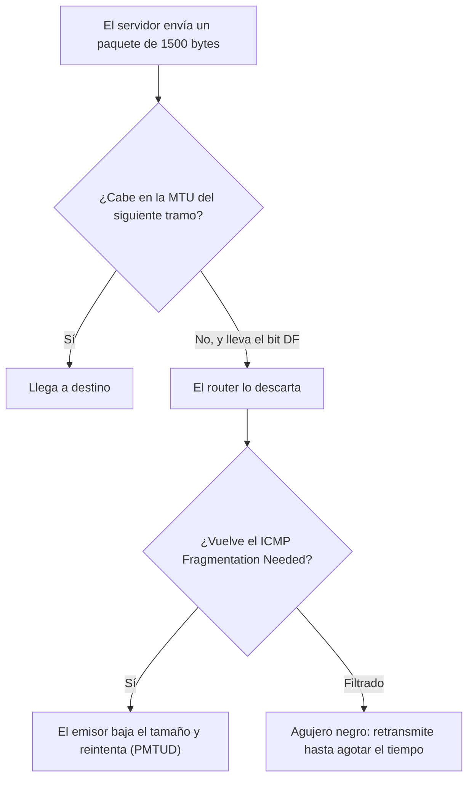

En el trabajo nos encontramos errores de conexión entre servidores difíciles de explicar: unas conexiones funcionaban y otras se quedaban colgadas sin motivo aparente. Uno de los sospechosos era una MTU distinta entre servidores y puertos del switch. No afirmo que ésa acabara siendo la causa, porque este tipo de fallo solo se confirma midiendo, pero me di cuenta de que no entendía del todo cómo funciona la MTU por dentro, así que me puse a aprenderlo en serio. Este artículo es lo que encontré: qué es la MTU, qué pasa de verdad cuando los dos extremos del camino no coinciden, cómo diagnosticar el problema con herramientas que ya tienes y cómo se arregla.

## El síntoma

Un problema de MTU tiene una firma muy reconocible: los paquetes pequeños pasan y los grandes no.

- `ping` funciona, porque sus paquetes por defecto son pequeños.
- SSH conecta, pero se congela en cuanto algo saca mucho texto por pantalla, como un listado largo o un `cat` de un archivo grande.
- Las negociaciones TLS se quedan a medias y las páginas HTTPS no terminan de cargar.
- Las transferencias arrancan bien y mueren a los pocos kilobytes.

Los errores parecen aleatorios e intermitentes porque dependen del tamaño del paquete, no de la hora ni de la carga. Si ese patrón te suena, la MTU merece un puesto en la lista de sospechosos. Otros fallos producen síntomas parecidos (una tarjeta de red defectuosa, congestión), así que la idea no es dar nada por hecho: es medir.

## Qué es la MTU

La MTU (unidad máxima de transmisión, del inglés *Maximum Transmission Unit*) es el paquete más grande que una interfaz envía de una vez. En Ethernet, el estándar (IEEE 802.3) lo fija en 1500 bytes, y ése es el valor por defecto en casi todas partes.

Una analogía útil: el límite de altura de los puentes de una carretera. Un camión más alto que el puente más bajo de su ruta no pasa, aunque todos los puentes de su ciudad sean altos. Tu servidor puede tener una MTU perfectamente válida y fallar igualmente porque algún tramo del camino es más bajo.

Valores típicos:

| MTU | Dónde aparece |
| --- | --- |
| 1500 | Ethernet estándar, el valor por defecto |
| 9000 | Tramas gigantes (*jumbo frames*), habituales en redes de datacenter y almacenamiento |
| ~1450 | Overlays y túneles (VXLAN, algunas redes de nube), por las cabeceras extra |
| 1280 | Mínimo obligatorio en IPv6 (RFC 8200) |

## Qué pasa cuando no coincide

IPv4 podría en teoría fragmentar los paquetes por el camino, pero el tráfico TCP actual casi siempre lleva el bit DF (del inglés *Don't Fragment*, no fragmentar), así que los routers no pueden trocearlo. Cuando un paquete con DF llega a un tramo cuya MTU es menor, el router lo descarta y debería devolver un mensaje ICMP *Fragmentation Needed* (tipo 3, código 4) con la MTU que sí cabe. El emisor baja entonces el tamaño de paquete para ese destino y reintenta. Ese mecanismo es el descubrimiento de MTU de ruta (*Path MTU Discovery*, PMTUD), definido en el RFC 1191.

Cuando PMTUD funciona, un desajuste cuesta un reintento y la conexión sigue, algo más lenta. No te enteras de nada.

## El agujero negro del ICMP

El modo de fallo detrás de los síntomas raros es el agujero negro (*black hole*): un firewall o filtro en el camino descarta el tráfico ICMP, así que el aviso de *Fragmentation Needed* nunca llega al emisor. Éste retransmite el paquete a tamaño completo hasta que la conexión agota el tiempo de espera. Los paquetes pequeños pasan y los grandes desaparecen sin explicación. Es exactamente la firma del primer apartado.

Los culpables habituales son los firewalls excesivamente estrictos: bloquear todo el ICMP entrante rompe PMTUD, que depende de él. Cloudflare tiene un buen artículo sobre cómo se da esto en la práctica (enlazado en las referencias), y es un tema recurrente en despliegues de VPN y túneles, donde la sobrecarga del túnel reduce la MTU efectiva por debajo de lo que los extremos asumen.

## Jumbo frames y la regla del dominio L2

Las tramas gigantes (*jumbo frames*, normalmente de 9000 bytes) son habituales en redes de datacenter, porque los paquetes más grandes reducen la sobrecarga por paquete en el tráfico de almacenamiento y replicación. Aquí importan dos cosas:

- 9000 es una convención, no un estándar. Cada equipo elige su propio máximo y no todos coinciden.
- Todo el dominio de capa 2 (dominio L2) debe ir al mismo valor: cada servidor, puerto de switch y VLAN del camino necesita la misma MTU.

Si un servidor configurado a 9000 habla con un puerto de switch configurado a 1500, las tramas grandes se descartan en silencio en capa 2. No hay aviso ICMP ni PMTUD, porque un switch no enruta, no fragmenta ni envía errores: simplemente tira lo que no cabe. Es la variante más traicionera del problema, porque nada en los logs la explica.

## Diagnóstico paso a paso

1. Mira la MTU de cada interfaz, en los dos extremos: `ip link show`.
2. Mide la MTU real de la ruta con `ping -M do -s 1472 <destino>`. `-M do` activa el bit DF y `-s 1472` es el tamaño de los datos; 1472 de datos + 20 bytes de cabecera IP + 8 bytes de cabecera ICMP = 1500. Si pasa, la ruta admite 1500. Si no, baja el valor hasta que pase: el mayor valor que funciona más 28 es la MTU de la ruta.
3. `tracepath <destino>` muestra la MTU de la ruta directamente y a menudo el salto donde cambia.
4. Prueba en los dos sentidos. Arreglar uno no arregla el otro.
5. Interpreta los resultados. Un error `message too long, mtu=X` es buena noticia: PMTUD funciona y X te da el límite. El silencio total significa que algo filtra ICMP.
6. Comprueba si los avisos llegan siquiera: `sudo tcpdump -ni <interfaz> icmp` mientras lanzas los pings grandes.
7. En switches gestionables, revisa la MTU por puerto y por VLAN y los contadores de descartes, que es donde se ven las caídas silenciosas de capa 2.

| Comando | Qué te dice |
| --- | --- |
| `ip link show` | La MTU configurada en cada interfaz |
| `ping -M do -s 1472 <destino>` | Si la ruta admite paquetes de 1500 bytes sin fragmentar |
| `tracepath <destino>` | La MTU descubierta de la ruta y el salto donde baja |
| `sudo tcpdump -ni <interfaz> icmp` | Si los avisos ICMP de fragmentación llegan de verdad |

## Cómo se arregla

- **Alinea la MTU en todo el camino.** Éste es el arreglo correcto. Si activas jumbo frames, pon el mismo valor en cada equipo del dominio L2.
- **Baja la MTU en el extremo** cuando no controlas el camino: `ip link set dev <interfaz> mtu 1450`, y hazlo persistente en la configuración de red. Ten en cuenta que esto arregla un sentido en un equipo.
- **Activa PLPMTUD como red de seguridad**: define `net.ipv4.tcp_mtu_probing=1` (RFC 4821). TCP sondea entonces un tamaño que funcione por su cuenta cuando los paquetes se pierden, sin depender de ICMP. El valor `1` sondea solo cuando se sospecha un agujero negro; `2` sondea siempre. La [documentación de ip-sysctl del kernel](https://www.kernel.org/doc/html/latest/networking/ip-sysctl.html) describe ambos.
- **Limitación del MSS (*MSS clamping*) en el router o firewall**: reescribe la opción MSS de las conexiones TCP que pasan para que nunca intenten paquetes más grandes de lo que la ruta admite (por ejemplo con el objetivo `TCPMSS` de iptables y `--clamp-mss-to-pmtu`). Funciona, pero es un parche que oculta el desajuste en lugar de arreglarlo.

> [!WARNING]
> Cambies lo que cambies, prueba después en los dos sentidos. Una ruta que funciona de A a B puede seguir rota de B a A.

## Nota sobre Kubernetes

Las redes overlay gastan parte de la MTU en sus propias cabeceras. Con flannel en modo VXLAN, la encapsulación añade 50 bytes de cabeceras, así que la MTU dentro de un pod queda 50 bytes por debajo de la red física: típicamente 1450 sobre una red estándar de 1500. Compara `ip link show` en el nodo y dentro de un pod para ver ambos valores. Si la MTU del pod es mayor de lo que la red subyacente admite entre nodos, se repiten las mismas caídas silenciosas de antes, esta vez entre pods de nodos distintos.

## Glosario

- **MTU (unidad máxima de transmisión)**: el paquete más grande que una interfaz envía de una vez. 1500 bytes en Ethernet estándar.
- **DF (*Don't Fragment*)**: bit de la cabecera IPv4 que prohíbe a los routers trocear el paquete. El tráfico TCP casi siempre lo lleva.
- **ICMP**: protocolo que usan los equipos de red para notificar errores, incluidos los avisos de *Fragmentation Needed*.
- **Descubrimiento de MTU de ruta (*Path MTU Discovery*, PMTUD)**: mecanismo (RFC 1191) por el que el emisor aprende la MTU más pequeña del camino a partir de los avisos ICMP y baja el tamaño de sus paquetes.
- **Agujero negro (*black hole*)**: ruta donde los avisos ICMP se filtran, de modo que el emisor nunca sabe por qué desaparecen sus paquetes grandes.
- **Tramas gigantes (*jumbo frames*)**: tramas Ethernet más grandes que los 1500 bytes estándar, normalmente de 9000. Una convención, no un estándar; todo el dominio L2 debe coincidir.
- **Dominio de capa 2 (dominio L2)**: el conjunto de equipos y puertos conectados a nivel Ethernet (switches, VLAN, puertos de servidor) sin enrutado intermedio.
- **Limitación del MSS (*MSS clamping*)**: reescritura de la opción de tamaño máximo de segmento de TCP en tránsito, para que las conexiones no intenten paquetes demasiado grandes.
- **VXLAN**: protocolo de red overlay que encapsula tráfico de capa 2 sobre UDP, añadiendo 50 bytes de cabeceras por paquete.

## Resumen

- La firma de una MTU distinta es inconfundible: los paquetes pequeños pasan y los grandes se cuelgan. El SSH que conecta y luego se congela es el caso clásico.
- PMTUD depende de que los avisos ICMP *Fragmentation Needed* vuelvan. Si un firewall los filtra, la ruta se convierte en un agujero negro y las conexiones se cuelgan sin explicación.
- Los jumbo frames son todo o nada: todos los equipos del dominio L2 deben compartir la misma MTU, o las tramas grandes mueren en silencio en el switch.
- Diagnostica midiendo, no suponiendo: `ping -M do -s 1472`, `tracepath`, en los dos sentidos, y `tcpdump` para ver si los avisos ICMP llegan.
- El arreglo de verdad es alinear la MTU a lo largo del camino; `net.ipv4.tcp_mtu_probing=1` es una buena red de seguridad mientras llegas.

## Referencias

- [RFC 1191: Path MTU Discovery](https://www.rfc-editor.org/rfc/rfc1191.html)
- [RFC 4821: Packetization Layer Path MTU Discovery](https://www.rfc-editor.org/rfc/rfc4821.html)
- [RFC 8200: IPv6 (MTU mínima de 1280 bytes)](https://www.rfc-editor.org/rfc/rfc8200.html)
- [Cloudflare: Path MTU Discovery in practice](https://blog.cloudflare.com/path-mtu-discovery-in-practice/)
- [Hetzner Docs: MTU troubleshooting](https://docs.hetzner.com/networking/networks/troubleshooting/mtu/)
- [NETGEAR: Guidance on the use of jumbo frames](https://kb.netgear.com/25091/Guidance-on-the-use-of-jumbo-frames)
- [flannel issue #1775: setting MTU in kube-flannel.yml](https://github.com/flannel-io/flannel/issues/1775)
- [Kernel de Linux: documentación de ip-sysctl (`tcp_mtu_probing`)](https://www.kernel.org/doc/html/latest/networking/ip-sysctl.html)
